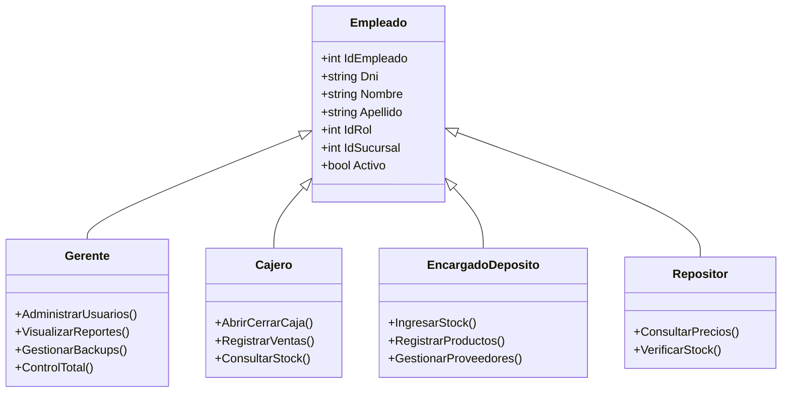
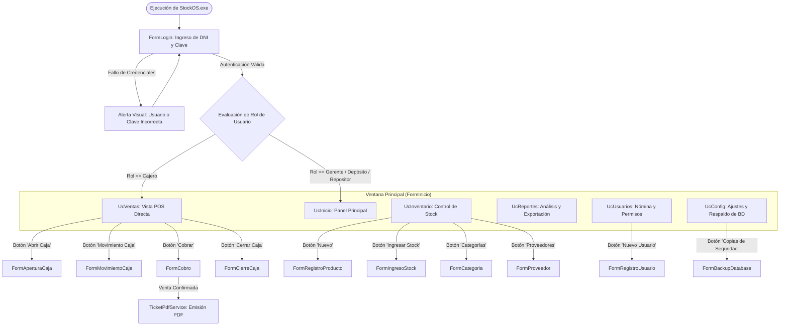
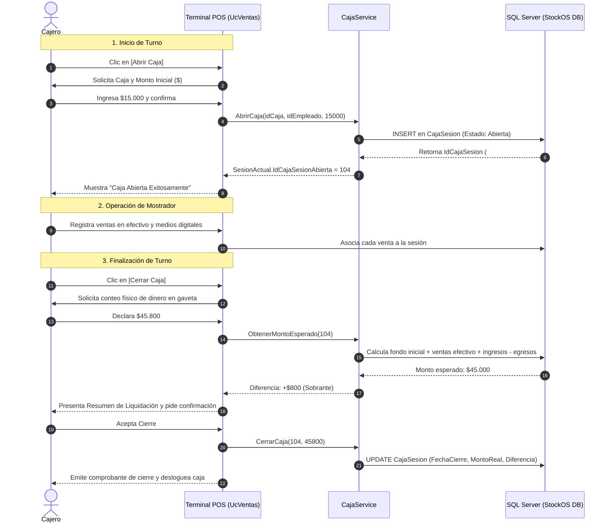
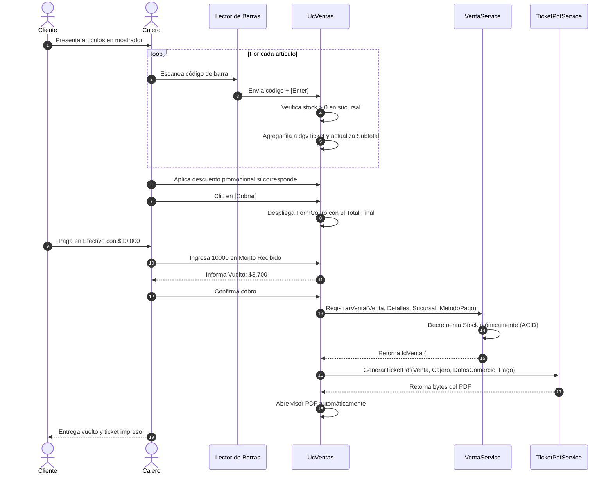

# StockOS — Sistema de Gestión Comercial, Punto de Venta (POS) e Inventario
## Manual Oficial de Usuario y Guía de Operatoria del Sistema

---

### Metadatos Académicos e Institucionales
- **Institución:** Universidad Nacional del Nordeste (UNNE)
- **Facultad:** Facultad de Ciencias Exactas y Naturales y Agrimensura (FaCENA)
- **Carrera:** Licenciatura en Sistemas de Información
- **Asignatura:** Taller de Programación 2 (Ciclo Lectivo 2026)
- **Docente Titular / Evaluador:** Prof. Juan Andrés Carruthers
- **Autores del Proyecto:**
  - Arnica, Saúl Agustín — D.N.I.: 43.205.368
  - Zimerman, Benjamín — D.N.I.: 43.064.294
- **Versión del Software:** 1.0.0 (Release Candidate)
- **Tecnología:** .NET 8.0 (C#) — Windows Forms — Microsoft SQL Server
- **Fecha de Emisión:** 4 de Noviembre de 2026

---

## Control de Versiones del Documento

| Versión | Fecha | Autor(es) | Descripción del Cambio / Alcance |
| :---: | :---: | :---: | :--- |
| `1.0.0` | `04/11/2026` | Arnica, S. A. & Zimerman, B. | Versión oficial integral y personalizada para StockOS. Detalla la totalidad de formularios, controles de usuario (UserControls), matriz de roles RBAC, operatoria de caja, punto de venta (POS), inventario, compras, reportes y módulo de copias de seguridad de base de datos. |

---

## Índice General

1. [Introducción y Objetivos del Manual](#1-introducción-y-objetivos-del-manual)
   - 1.1 [Propósito del Documento](#11-propósito-del-documento)
   - 1.2 [Audiencia Objetivo y Perfiles Destinatarios](#12-audiencia-objetivo-y-perfiles-destinatarios)
   - 1.3 [Convenciones Visuales y Tipográficas](#13-convenciones-visuales-y-tipográficas)
2. [Requisitos del Sistema y Puesta en Marcha](#2-requisitos-del-sistema-y-puesta-en-marcha)
   - 2.1 [Requisitos Mínimos y Recomendados de Hardware](#21-requisitos-mínimos-y-recomendados-de-hardware)
   - 2.2 [Requisitos de Software y Dependencias](#22-requisitos-de-software-y-dependencias)
   - 2.3 [Instalación, Cadena de Conexión y Primer Acceso](#23-instalación-cadena-de-conexión-y-primer-acceso)
   - 2.4 [Credenciales de Prueba Preconfiguradas](#24-credenciales-de-prueba-preconfiguradas)
3. [Roles de Usuario y Matriz de Permisos (RBAC)](#3-roles-de-usuario-y-matriz-de-permisos-rbac)
   - 3.1 [Definición de Actores / Roles del Comercio](#31-definición-de-actores--roles-del-comercio)
   - 3.2 [Matriz de Control de Acceso por Módulo y Permiso](#32-matriz-de-control-de-acceso-por-módulo-y-permiso)
4. [Estructura General y Mapa de Navegación](#4-estructura-general-y-mapa-de-navegación)
   - 4.1 [Diagrama de Navegación de la Aplicación](#41-diagrama-de-navegación-de-la-aplicación)
   - 4.2 [Estructura del Área de Trabajo (Dock Flotante y Header)](#42-estructura-del-área-de-trabajo-dock-flotante-y-header)
5. [Guía Operativa Detallada por Pantalla y Módulo](#5-guía-operativa-detallada-por-pantalla-y-módulo)
   - 5.1 [Pantalla: Inicio de Sesión (`FormLogin`)](#51-pantalla-inicio-de-sesión-formlogin)
   - 5.2 [Pantalla: Ventana Principal y Panel de Inicio (`FormInicio` y `UcInicio`)](#52-pantalla-ventana-principal-y-panel-de-inicio-forminicio-y-ucinicio)
   - 5.3 [Pantalla: Punto de Venta / Facturación POS (`UcVentas`)](#53-pantalla-punto-de-venta--facturación-pos-ucventas)
   - 5.4 [Pantalla: Apertura de Turno de Caja (`FormAperturaCaja`)](#54-pantalla-apertura-de-turno-de-caja-formaperturacaja)
   - 5.5 [Pantalla: Movimientos Extraordinarios de Caja (`FormMovimientoCaja`)](#55-pantalla-movimientos-extraordinarios-de-caja-formmovimientocaja)
   - 5.6 [Pantalla: Pasarela de Cobro y Vuelto (`FormCobro`)](#56-pantalla-pasarela-de-cobro-y-vuelto-formcobro)
   - 5.7 [Pantalla: Cierre de Turno y Arqueo de Caja (`FormCierreCaja`)](#57-pantalla-cierre-de-turno-y-arqueo-de-caja-formcierrecaja)
   - 5.8 [Comprobantes: Emisión y Visualización de Ticket Térmico PDF](#58-comprobantes-emisión-y-visualización-de-ticket-térmico-pdf)
   - 5.9 [Pantalla: Administración de Inventario y Catálogo (`UcInventario`)](#59-pantalla-administración-de-inventario-y-catálogo-ucinventario)
   - 5.10 [Pantalla: Alta y Modificación de Producto (`FormRegistroProducto`)](#510-pantalla-alta-y-modificación-de-producto-formregistroproducto)
   - 5.11 [Pantalla: Ingreso de Mercadería y Compras (`FormIngresoStock`)](#511-pantalla-ingreso-de-mercadería-y-compras-formingresostock)
   - 5.12 [Pantalla: Mantenimiento de Categorías (`FormCategoria`)](#512-pantalla-mantenimiento-de-categorías-formcategoria)
   - 5.13 [Pantalla: Mantenimiento de Proveedores (`FormProveedor`)](#513-pantalla-mantenimiento-de-proveedores-formproveedor)
   - 5.14 [Pantalla: Gestión y Auditoría de Empleados (`UcUsuarios` y `FormRegistroUsuario`)](#514-pantalla-gestión-y-auditoría-de-empleados-ucusuarios-y-formregistrousuario)
   - 5.15 [Pantalla: Módulo de Reportes Analíticos (`UcReportes`)](#515-pantalla-módulo-de-reportes-analíticos-ucreportes)
   - 5.16 [Pantalla: Configuración, Información y Backups (`UcConfig` y `FormBackupDatabase`)](#516-pantalla-configuración-información-y-backups-ucconfig-y-formbackupdatabase)
6. [Flujos Operativos Críticos Transaccionales Paso a Paso](#6-flujos-operativos-críticos-transaccionales-paso-a-paso)
   - 6.1 [Flujo 1: Ciclo Completo de Caja (Apertura $\rightarrow$ Operación $\rightarrow$ Cierre con Arqueo)](#61-flujo-1-ciclo-completo-de-caja-apertura--operación--cierre-con-arqueo)
   - 6.2 [Flujo 2: Venta en Mostrador con Lector de Barras, Descuento y Cobro](#62-flujo-2-venta-en-mostrador-con-lector-de-barras-descuento-y-cobro)
   - 6.3 [Flujo 3: Ingreso de Mercadería, Compra y Actualización de Precios](#63-flujo-3-ingreso-de-mercadería-compra-y-actualización-de-precios)
   - 6.4 [Flujo 4: Respaldo y Restauración de Base de Datos ante Contingencias](#64-flujo-4-respaldo-y-restauración-de-base-de-datos-ante-contingencias)
7. [Manejo de Errores, Validaciones de Campo y Contingencias](#7-manejo-de-errores-validaciones-de-campo-y-contingencias)
   - 7.1 [Alertas Visuales y Ayudas Emergentes (Globos ToolTip)](#71-alertas-visuales-y-ayudas-emergentes-globos-tooltip)
   - 7.2 [Catálogo de Mensajes de Error y Soluciones Operativas](#72-catálogo-de-mensajes-de-error-y-soluciones-operativas)
8. [Preguntas Frecuentes (FAQ) y Soporte Técnico Oficial](#8-preguntas-frecuentes-faq-y-soporte-técnico-oficial)
   - 8.1 [Preguntas Frecuentes](#81-preguntas-frecuentes)
   - 8.2 [Canal Oficial de Asistencia Técnica](#82-canal-oficial-de-asistencia-técnica)

---

## 1. Introducción y Objetivos del Manual

### 1.1 Propósito del Documento
El presente documento constituye el **Manual Oficial de Usuario y Guía de Operatoria del Sistema StockOS**. Su finalidad es instruir al personal del comercio (cajeros, repositores, encargados de depósito y gerentes) en la correcta operación de las herramientas del sistema, garantizando la consistencia del inventario, la seguridad en la recaudación de cajas y la agilidad en la atención en el punto de venta.

### 1.2 Audiencia Objetivo y Perfiles Destinatarios
- **Cajeros / Vendedores de Mostrador:** Personal responsable de la apertura y cierre de su caja diaria, registro de cobros en efectivo o medios electrónicos, aplicación de promociones y emisión de comprobantes fiscales/térmicos.
- **Repositores de Salón:** Personal a cargo de la consulta de precios, verificación de códigos de barra e inspección visual de existencias mínimas.
- **Encargados de Depósito:** Responsables del ingreso formal de mercadería, altas de productos, recepción de compras y relación con proveedores.
- **Gerentes / Administradores de Sucursal:** Supervisores con atribuciones plenas para la auditoría de arqueos, gestión de empleados, análisis de ventas y políticas de seguridad informática.

### 1.3 Convenciones Visuales y Tipográficas
- **`[Nombre de Botón]`**: Identifica un botón o elemento interactivo ejecutable (ej. `[Cobrar]`, `[Abrir Caja]`).
- **`Campo en Negrita`**: Representa una etiqueta o caja de texto de carga de información (ej. **DNI**, **Monto Inicial**).
- **`Código / Tecla`**: Teclas rápidas del teclado o valores del sistema (ej. `[Enter]`, `Esc`, `BCrypt`).
- **Bloques de Advertencia:**
  - > [!NOTE] Información relevante sobre el comportamiento automático del software.
  - > [!IMPORTANT] Paso obligatorio para no interrumpir el flujo operativo del negocio.
  - > [!WARNING] Advertencia sobre operaciones que afectan los registros contables o el stock.
  - > [!CAUTION] Alerta crítica sobre procedimientos irreversibles (anulación de ventas, restauración de bases de datos).

---

## 2. Requisitos del Sistema y Puesta en Marcha

### 2.1 Requisitos Mínimos y Recomendados de Hardware

| Componente | Requisito Mínimo (Punto de Venta) | Requisito Recomendado (Servidor / Gerencia) |
| :--- | :--- | :--- |
| **Procesador (CPU)** | Arquitectura x64 Dual-Core a 2.0 GHz | Intel Core i3/i5 o AMD Ryzen 3/5 Quad-Core a 2.5+ GHz |
| **Memoria RAM** | 4 GB | 8 GB o superior |
| **Almacenamiento** | 2 GB libres en disco duro (HDD/SSD) | 10 GB libres en unidad de estado sólido (SSD NVMe) |
| **Pantalla** | Resolución de 1280 × 720 píxeles | Resolución Full HD (1920 × 1080 píxeles) |
| **Periféricos** | Teclado, mouse y lector óptico de código de barras USB | Lector de código de barras e impresora térmica de tickets (ESC/POS 80mm/58mm) |

### 2.2 Requisitos de Software y Dependencias
- **Sistema Operativo:** Microsoft Windows 10 (Build 19041+) o Windows 11 (64-bit). Compatible con Windows Server 2019/2022.
- **Plataforma de Ejecución:** Microsoft .NET Desktop Runtime 8.0 (x64).
- **Motor de Base de Datos:** Microsoft SQL Server 2019 / 2022 (ediciones LocalDB, Express, Standard o Enterprise).
- **Software Visor de PDF:** Microsoft Edge, Adobe Acrobat Reader o cualquier navegador web predeterminado para la apertura automática de comprobantes.

### 2.3 Instalación, Cadena de Conexión y Primer Acceso
1. **Configuración de Base de Datos:**
   - La cadena de conexión reside en el archivo [`appsettings.json`](file:///C:/Proyecto/StockOS/src/StockOS.UI.WinForms/appsettings.json) ubicado en la raíz del ejecutable:
   ```json
   {
     "ConnectionStrings": {
       "DefaultConnection": "Server=localhost;Database=StockOS;Trusted_Connection=True;TrustServerCertificate=True;"
     },
     "DatosComercio": {
       "NombreComercio": "StockOS Retail",
       "Direccion": "Av. Libertad 5450, Corrientes",
       "Cuit": "30-71234567-9",
       "PuntoVenta": 1
     }
   }
   ```
2. **Puesta en Marcha:**
   - Hacer doble clic sobre `StockOS.UI.WinForms.exe`.
   - El sistema inicializará el contenedor de inyección de dependencias (`Microsoft.Extensions.DependencyInjection`), configurará el motor de logging Serilog (`logs/stockos-.log`) y presentará la pantalla de login.

### 2.4 Credenciales de Prueba Preconfiguradas

Para entornos de auditoría, pruebas o capacitación del personal, el sistema incluye usuarios predefinidos:

| Empleado | DNI (Usuario) | Contraseña | Rol Asignado | Sucursal |
| :--- | :---: | :---: | :--- | :--- |
| **Admin 1** | `43000111` | `admin123` | **Gerente (Administrador)** | Casa Central (ID: 1) |
| **Admin 2** | `43000222` | `admin123` | **Gerente (Administrador)** | Casa Central (ID: 1) |
| **Cajero 1** | `66333999` | `cajero12` | **Cajero** | Casa Central (ID: 1) |
| **Deposito 1**| `44555666` | `depo123` | **Encargado de Depósito** | Casa Central (ID: 1) |
| **Repositor 1**| `11222333` | `repo123` | **Repositor** | Casa Central (ID: 1) |

---

## 3. Roles de Usuario y Matriz de Permisos (RBAC)

### 3.1 Definición de Actores / Roles del Comercio



- **Gerente (Rol ID: 1):** Administrador general. Posee permisos irrestrictos sobre todos los módulos del software.
- **Cajero (Rol ID: 2):** Operador de terminal POS. Su interfaz prioriza de forma directa la pantalla de ventas y el control estricto de su caja.
- **Encargado de Depósito (Rol ID: 3):** Responsable de compras e inventario. Puede dar de alta productos, recibir órdenes de compra y gestionar proveedores.
- **Repositor (Rol ID: 4):** Personal de salón. Posee permisos de solo lectura para auditar existencias y cotejar precios en góndola.

### 3.2 Matriz de Control de Acceso por Módulo y Permiso

La validación es interceptada a nivel centralizado por el servicio [`AuthorizationService`](file:///C:/Proyecto/StockOS/src/StockOS.Application/Services/AuthorizationService.cs):

| Código de Permiso Formal | Operación en el Sistema | Gerente (1) | Cajero (2) | Enc. Depósito (3) | Repositor (4) |
| :--- | :--- | :---: | :---: | :---: | :---: |
| `USUARIOS_VER` | Ver listado y fichas de empleados | ✅ | ❌ | ❌ | ❌ |
| `USUARIOS_CREAR` | Registrar nuevos empleados | ✅ | ❌ | ❌ | ❌ |
| `USUARIOS_EDITAR` | Modificar datos, roles y claves | ✅ | ❌ | ❌ | ❌ |
| `PRODUCTOS_VER` | Consultar catálogo de productos | ✅ | ✅ | ✅ | ✅ |
| `PRODUCTOS_CREAR` | Crear nuevos productos | ✅ | ❌ | ✅ | ❌ |
| `PRODUCTOS_EDITAR` | Modificar precios, nombres o dar baja | ✅ | ❌ | ✅ | ❌ |
| `CATEGORIAS_GESTIONAR` | Alta y edición de categorías | ✅ | ❌ | ✅ | ❌ |
| `STOCK_VER` | Visualizar cantidades disponibles | ✅ | ✅ | ✅ | ✅ |
| `STOCK_INGRESAR` | Registrar ingresos por compras | ✅ | ❌ | ✅ | ❌ |
| `VENTAS_REALIZAR` | Operar el Punto de Venta y facturar | ✅ | ✅ | ❌ | ❌ |
| `CAJA_ABRIR` | Apertura de turno de caja | ✅ | ✅ | ❌ | ❌ |
| `CAJA_CERRAR` | Arqueo y cierre de turno | ✅ | ✅ | ❌ | ❌ |
| `CAJA_MOVIMIENTOS` | Egresos e ingresos extraordinarios | ✅ | ✅ | ❌ | ❌ |
| `REPORTES_VER` | Reportes de ventas y compras en PDF | ✅ | ❌ | ❌ | ❌ |
| `COMPRAS_GESTIONAR` | Histórico y registro de compras | ✅ | ❌ | ✅ | ❌ |
| `PROVEEDORES_GESTIONAR`| Mantenimiento de proveedores | ✅ | ❌ | ✅ | ❌ |
| `CONFIGURACION_GESTIONAR`| Backups de DB y configuración | ✅ | ❌ | ❌ | ❌ |

---

## 4. Estructura General y Mapa de Navegación

### 4.1 Diagrama de Navegación de la Aplicación



### 4.2 Estructura del Área de Trabajo (Dock Flotante y Header)

La interfaz de usuario adopta un esquema ergonómico moderno en tonalidades oscuras (*Dark Theme*):
- **Barra Superior (`pnlHeader`):** Muestra el título contextual del módulo, el nombre y apellido del usuario autenticado, su rol y sucursal. En el extremo superior derecho se ubica el botón rojo `[Cerrar Sesión / Salir]`.
- **Área Contenedora (`pnlContenedor`):** Panel dinámico central donde se instancian los controles de usuario (`UserControl`) según la pestaña seleccionada.
- **Dock de Navegación Flotante (`dockPanel`):** Panel inferior con esquinas redondeadas (`BorderRadius = 25`) que agrupa los botones principales de navegación con retroalimentación visual al posar el cursor (*hover* color verde esmeralda `#10B981`).

```
+-----------------------------------------------------------------------------------------------+
| StockOS | Sucursal: 1 | Benjamín Zimerman (Gerente)                     [ CERRAR SESIÓN (X) ] |
+-----------------------------------------------------------------------------------------------+
|                                                                                               |
|                                                                                               |
|                                  ÁREA DE TRABAJO PRINCIPAL                                    |
|                       (UcVentas / UcInventario / UcInicio / etc.)                            |
|                                                                                               |
|                                                                                               |
|                         +---------------------------------------------------+                 |
|                         |  Inicio  |  Inventario  |  Ventas  |  Reportes... |  <- DOCK FLOTANTE|
|                         +---------------------------------------------------+                 |
+-----------------------------------------------------------------------------------------------+
```

---

## 5. Guía Operativa Detallada por Pantalla y Módulo

---

### 5.1 Pantalla: Inicio de Sesión (`FormLogin`)

```
+---------------------------------------------------------------+
|                            STOCKOS                            |
|                    Acceso Seguro al Sistema                   |
|                                                               |
|   DNI / Usuario:   [ 43000111                   ]             |
|   Contraseña:      [ **********                 ]             |
|                                                               |
|   [lblError: Credenciales correctas / DNI obligatorio]         |
|                                                               |
|                     [   INGRESAR   ]                          |
+---------------------------------------------------------------+
```

- **Propósito:** Autenticar de manera segura al empleado, validar su vigencia en la nómina, verificar su contraseña encriptada mediante algoritmo BCrypt y preparar la sesión de trabajo.
- **Precondiciones:** Conexión activa a SQL Server.

#### Catálogo de Controles de la Pantalla

| Control | Nombre Técnico | Tipo | Validación / Restricción | Descripción |
| :--- | :--- | :---: | :--- | :--- |
| **DNI / Usuario** | `txtUsuario` | TextBox | Máximo 20 caracteres. Solo números (`ValidadorUI.ConfigurarSoloNumeros`). | Documento de identidad del empleado. |
| **Contraseña** | `txtPassword` | TextBox | Modo contraseña (`UseSystemPasswordChar = true`). | Clave privada del usuario. |
| **Etiqueta Error** | `lblError` | Label | Dinámica: Verde para éxito, Rojo para error. | Mensaje de feedback reactivo. |
| **[Ingresar]** | `btnIngresar` | Button | Habilitado si los datos no están vacíos. | Inicia el proceso asíncrono de autenticación. |

#### Procedimiento Paso a Paso
1. Ingrese el número de DNI en el campo **DNI / Usuario** (el sistema no permitirá ingresar letras ni símbolos).
2. Escriba su contraseña secreta en **Contraseña**.
3. Presione `[Enter]` o haga clic en `[Ingresar]`.
4. El sistema evaluará las credenciales:
   - **Autenticación Válida:** Se muestra el mensaje `"Ingreso exitoso"` en color verde, se limpia cualquier sesión de caja previa huérfana y se abre `FormInicio`.
   - **Autenticación Fallida:** Se muestra `"Credenciales incorrectas"` en rojo y el cursor se enfoca en el campo de contraseña con el texto seleccionado para su corrección inmediata.

---

### 5.2 Pantalla: Ventana Principal y Panel de Inicio (`FormInicio` y `UcInicio`)

```
+-----------------------------------------------------------------------------------------------+
| Bienvenido a StockOS — Benjamín Zimerman | Rol: Gerente                                       |
+-----------------------------------------------------------------------------------------------+
|  RESUMEN OPERATIVO DEL COMERCIO                                                               |
|                                                                                               |
|  +--------------------------+  +--------------------------+  +-----------------------------+  |
|  |    Total Productos       |  |     Alertas de Stock     |  |      Estado de Caja         |  |
|  |          142             |  |   5 Productos en Mínimo  |  |    Turno Abierto: #104      |  |
|  +--------------------------+  +--------------------------+  +-----------------------------+  |
|                                                                                               |
|  ACCESOS DIRECTOS SEGÚN SU ROL:                                                               |
|  [ + Abrir Punto de Venta ]    [ Ver Inventario ]    [ Ingreso de Remito ]    [ Reportes ]    |
+-----------------------------------------------------------------------------------------------+
```

- **Propósito:** Servir como centro neurálgico de operaciones. Muestra información en tiempo real del comercio, accesos directos y controla el enrutamiento de vistas.
- **Lógica de Roles en Inicio:**
  - Si el usuario logueado es **Cajero**, el sistema salta automáticamente `UcInicio` y lo posiciona directamente en **`UcVentas`** para evitar demoras operativas.
  - Si el usuario es **Gerente**, **Encargado de Depósito** o **Repositor**, se muestra `UcInicio` con tarjetas de resumen adaptadas.

---

### 5.3 Pantalla: Punto de Venta / Facturación POS (`UcVentas`)

```
+-----------------------------------------------------------------------------------------------+
| Ventas | Cajero: Juan Pérez                     [ Abrir Caja ]  [ Movimiento ]  [ Cerrar Caja]|
+-----------------------------------------------------------------------------------------------+
| Cód. Barra: [ 7791234567890       ] [Buscar]                                                  |
+-----------------------------------------------------------------------------------------------+
| DETALLE DEL TICKET ACTUAL:                                                                    |
| | ID | Producto              | Cantidad | P. Unitario | Subtotal   | Acción                 | |
| |----|-----------------------|----------|-------------|------------|------------------------| |
| | 12 | Coca Cola 1.5L        |    2     | $ 2.500,00  | $ 5.000,00 | [Quitar]               | |
| | 45 | Galletitas Chocolinas |    1     | $ 1.800,00  | $ 1.800,00 | [Quitar]               | |
+-----------------------------------------------------------------------------------------------+
| Resumen de Liquidación:                                                                       |
| Subtotal: $ 6.800,00   |   Descuento: [ 500,00     ]   |   TOTAL FINAL: $ 6.300,00            |
|                                                            [   COBRAR (F12 / Clic)   ]        |
+-----------------------------------------------------------------------------------------------+
```

- **Propósito:** Facturación ágil en mostrador, control de existencias en tiempo real por sucursal, aplicación de descuentos ponderados y liquidación de ventas.

#### Reglas de Negocio Estrictas de Venta
> [!IMPORTANT]
> **Blindaje de Caja:** Para poder realizar un cobro, el cajero **debe haber abierto su turno de caja previamente**. Si intenta cobrar con la caja cerrada, el sistema emitirá el mensaje: `"No puedes cobrar porque no has abierto la caja. Haz clic en 'Abrir Caja' en la barra superior"`.

> [!WARNING]
> **Bloqueo de Venta sin Stock:** No es posible ingresar al ticket un producto que no posea stock físico registrado en la sucursal actual (`stock <= 0`). Si durante la carga se supera la cantidad disponible, el sistema bloquea el incremento alertando: `"No hay suficiente stock para '[Producto]'. Stock disponible: X, cargado en ticket: Y"`.

#### Procedimiento de Venta
1. Escanee el código de barras del producto con la pistola lectora o escríbalo manualmente en el campo **Cód. Barra** y presione `[Enter]`.
2. Si el producto ya se encuentra en el ticket, el sistema incrementará su cantidad en `+1` de manera automática y recalculará el subtotal.
3. Si desea otorgar un descuento general a la venta, ingrese el monto en el campo **Descuento** (el descuento no puede ser superior al subtotal).
4. Haga clic en el botón verde `[Cobrar]`. Se abrirá la pasarela de pago `FormCobro`.

---

### 5.4 Pantalla: Apertura de Turno de Caja (`FormAperturaCaja`)

```
+---------------------------------------------------------------+
|                       APERTURA DE CAJA                        |
|                                                               |
|   Seleccionar Caja:   [ Caja 1 - Mostrador Principal    v ]   |
|   Monto Inicial ($):  [ 15000.00                          ]   |
|                                                               |
|             [ Cancelar ]              [ Abrir Caja ]          |
+---------------------------------------------------------------+
```

- **Propósito:** Iniciar un nuevo turno de trabajo registrando el fondo inicial de cambio en efectivo asignado a la gaveta de dinero.
- **Validaciones:**
  - Solo permite seleccionar cajas pertenecientes a la sucursal del empleado en sesión.
  - El monto inicial no puede ser negativo (`montoApertura >= 0`).
  - Al confirmarse, el sistema guarda la sesión en base de datos (`IdCajaSesion`) y la asocia a `SesionActual.IdCajaSesionAbierta`.

---

### 5.5 Pantalla: Movimientos Extraordinarios de Caja (`FormMovimientoCaja`)

```
+---------------------------------------------------------------+
|                    MOVIMIENTO MANUAL DE CAJA                  |
|                                                               |
|   Tipo de Movimiento: [ EGRESO                        v ]     |
|   Monto ($):          [ 2500.00                         ]     |
|   Motivo / Concepto:  [ Compra de insumos de limpieza   ]     |
|                                                               |
|             [ Cancelar ]              [ Guardar ]             |
+---------------------------------------------------------------+
```

- **Propósito:** Registrar entradas o salidas de dinero en efectivo fuera del circuito habitual de ventas (ej. retiro de efectivo para pago a proveedores menores, compra de artículos de librería, reintegros extraordinarios).
- **Tipos de Movimiento:** `INGRESO` o `EGRESO`.
- **Efecto en el Arqueo:** El sistema suma o resta este monto del dinero total esperado al momento del cierre de caja.

---

### 5.6 Pantalla: Pasarela de Cobro y Vuelto (`FormCobro`)

```
+---------------------------------------------------------------+
|                         TOTAL A COBRAR                        |
|                           $ 6.300,00                          |
+---------------------------------------------------------------+
|   Monto Recibido ($): [ 10000.00                       ]      |
|   Vuelto a Entregar:  $ 3.700,00                              |
+---------------------------------------------------------------+
| SELECCIONE MÉTODO DE PAGO:                                    |
| [ 💵 Efectivo ]                  [ 💳 Tarjeta de Débito ]     |
| [ 💳 Tarjeta de Crédito ]        [ 📱 Mercado Pago ]          |
+---------------------------------------------------------------+
```

- **Propósito:** Seleccionar el canal financiero del cobro, calcular de manera automática el vuelto a entregar al cliente en pagos en efectivo y asentar la transacción en el libro de ventas.

#### Medios de Pago y Reglas de Validación
1. **Efectivo:**
   - Si no se ingresa un monto en **Monto Recibido**, el sistema asume pago exacto.
   - Si el monto recibido es inferior al total de la venta, el sistema rechaza la operación: `"El monto ingresado es menor al total a cobrar"`.
   - Si el monto es suficiente, calcula de inmediato el vuelto exacto:
     $$\text{Vuelto} = \text{Monto Recibido} - \text{Total Venta}$$
2. **Tarjeta de Débito / Tarjeta de Crédito / Mercado Pago:**
   - El monto recibido se equipara automáticamente al total de la venta y el vuelto es `$0,00`. No requiere manejo de cambio.

---

### 5.7 Pantalla: Cierre de Turno y Arqueo de Caja (`FormCierreCaja`)

```
+---------------------------------------------------------------+
|                    CIERRE Y LIQUIDACIÓN DE CAJA               |
|                                                               |
|   Ingrese Dinero Físico en Caja ($): [ 45800.00         ]     |
|                                                               |
|   [ Cancelar ]                         [ Confirmar Cierre ]   |
+---------------------------------------------------------------+
```

- **Propósito:** Efectuar el arqueo ciego o controlado de la caja al finalizar el turno del cajero.

#### Cálculo Automático del Arqueo
Al hacer clic en `[Confirmar Cierre]`, el sistema calcula en el backend el importe exacto que debería existir en efectivo:
$$\text{Monto Esperado} = \text{Monto Inicial} + \sum \text{Ventas Efectivo} + \sum \text{Ingresos Caja} - \sum \text{Egresos Caja}$$

Se despliega un cuadro de diálogo con el balance de auditoría:
```text
Resumen de Liquidación:
- Monto Esperado (Sistema): $ 45.000,00
- Monto Declarado (Cajero): $ 45.800,00
- Diferencia de Caja:       $   +800,00 (Sobrante)

¿Desea confirmar el cierre definitivo?
```
- **Si el cajero confirma:** La sesión de caja se cierra en la base de datos con la marca temporal actual, se persiste la diferencia de arqueo y se reinicia `SesionActual.IdCajaSesionAbierta = null`.

---

### 5.8 Comprobantes: Emisión y Visualización de Ticket Térmico PDF

Al confirmarse una venta de forma exitosa, el servicio [`TicketPdfService`](file:///C:/Proyecto/StockOS/src/StockOS.Application/Services/TicketPdfService.cs) ensambla un comprobante en formato PDF optimizado para impresoras térmicas de 80mm:

```text
================================================
                STOCKOS RETAIL
         Av. Libertad 5450, Corrientes
               CUIT: 30-71234567-9
================================================
Ticket N°: 0001-00000104     Fecha: 04/11/2026 18:30
Cajero: Juan Pérez            Punto Venta: 0001
------------------------------------------------
Cant.  Descripción          P.Unit.    Subtotal
  2    Coca Cola 1.5L      $2.500,00   $5.000,00
  1    Chocolinas          $1.800,00   $1.800,00
------------------------------------------------
Subtotal Bruto:                        $6.800,00
Descuento Aplicado:                    $  500,00
TOTAL FINAL:                           $6.300,00
------------------------------------------------
Método de Pago:     Efectivo
Monto Recibido:     $10.000,00
Vuelto Entregado:   $ 3.700,00
------------------------------------------------
      ¡Gracias por su compra! StockOS
================================================
```
- El archivo se genera en el directorio temporal del sistema (`%TEMP%/Ticket_[IdVenta].pdf`) y se lanza en pantalla automáticamente mediante el proceso del visor PDF por defecto.

---

### 5.9 Pantalla: Administración de Inventario y Catálogo (`UcInventario`)

```
+-----------------------------------------------------------------------------------------------+
| Inventario  [ Buscar: __________________ ] [ Filtro: Todos v ] [ Recargar ]                   |
|             [ + Nuevo Producto ]  [ + Ingresar Stock ]  [ Categorías ]  [ Proveedores ]       |
+-----------------------------------------------------------------------------------------------+
| Cód. Barra    | Nombre Producto       | Categoría | Proveedor  | Precio    | Stock | Estado   |
|---------------|-----------------------|-----------|------------|-----------|-------|----------|
| 7791234567890 | Coca Cola 1.5L        | Bebidas   | Coca Cola  | $2.500,00 |  45   | Activo   |
| 7799876543210 | Galletitas Chocolinas | Almacén   | Bagley S.A.| $1.800,00 |   4   | Activo   |
| 7790001112223 | Yerba Mate 1Kg        | Almacén   | Las Marías | $4.200,00 |   0   | Inactivo |
+-----------------------------------------------------------------------------------------------+
```

- **Propósito:** Control centralizado del catálogo de artículos, niveles de existencias, precios de venta y estado de comercialización.
- **Filtros en Tiempo Real:** Permite tipear el nombre o código de barra y seleccionar entre `Todos`, `Activos` o `Inactivos`.
- **Acciones Rápidas en Grilla:** Cada fila cuenta con enlaces clickeables de `Modificar` y `Dar de Baja / Reactivar` (condicionados al permiso `PRODUCTOS_EDITAR`).

---

### 5.10 Pantalla: Alta y Modificación de Producto (`FormRegistroProducto`)

```
+---------------------------------------------------------------+
|                 REGISTRO / EDICIÓN DE PRODUCTO                |
|                                                               |
|   Código de Barra: [ 7791234567890             ]              |
|   Nombre:          [ Coca Cola 1.5L            ]              |
|   Descripción:     [ Gaseosa sabor cola pet    ]              |
|   Categoría:       [ Bebidas                 v ]              |
|   Proveedor:       [ Distribuidora Norte     v ]              |
|   Precio Venta ($):[ 2500.00                   ]              |
|   Precio Compra:   [ 1600.00                   ]              |
|   IVA (%):         [ 21.00                   v ]              |
|   Estado:          [ Activo                  v ]              |
|                                                               |
|             [ Cancelar ]              [ Guardar ]             |
+---------------------------------------------------------------+
```

- **Propósito:** Dar de alta un nuevo artículo o modificar sus parámetros de comercialización.
- **Validaciones Automáticas:**
  - El código de barra es único. Si ya existe en otro producto, el sistema impide el guardado.
  - El precio de venta no puede ser menor o igual a cero.
  - Validación de solo caracteres alfanuméricos en código y números decimales en precios.

---

### 5.11 Pantalla: Ingreso de Mercadería y Compras (`FormIngresoStock`)

```
+---------------------------------------------------------------+
|                    INGRESO DE STOCK / COMPRA                  |
|                                                               |
|   Fecha de Remito: [ 04/11/2026            v ]                |
|   Código Producto: [ 7791234567890           ] [Buscar]       |
|   Nombre Producto: [ Coca Cola 1.5L          ]                |
|   Categoría:       [ Bebidas                 ]                |
|   Proveedor:       [ Coca Cola FEMSA         ]                |
|   Cantidad:        [ 50                      ]                |
|   Precio Compra ($)[ 1600.00                 ]                |
|   Margen Ganancia%:[ 50.00                   ]                |
|                                                               |
|   CÁLCULOS AUTOMÁTICOS:                                       |
|   Total de Compra: $ 80.000,00  |  Precio Venta Nuevo: $ 2.400|
|                                                               |
|             [ Cancelar ]          [ Confirmar Ingreso ]       |
+---------------------------------------------------------------+
```

- **Propósito:** Asentar la entrada física de mercadería adquirida a proveedores, registrar el costo contable y actualizar el stock de la sucursal actual.
- **Cálculo Reactivo:** Al modificar la **Cantidad**, el **Precio de Compra** o el **Margen de Ganancia %**, el sistema recalcula inmediatamente el precio de venta sugerido y el total de la orden de compra.

---

### 5.12 Pantalla: Mantenimiento de Categorías (`FormCategoria`)

```
+---------------------------------------------------------------+
|                     GESTIÓN DE CATEGORÍAS                     |
|                                                               |
|   Nombre Categoría: [ Golosinas y Snacks       ]              |
|   Descripción:      [ Productos de confitería  ]              |
|   Estado:           [ Activo                 v ]              |
|                                                               |
|   LISTADO DE CATEGORÍAS EXISTENTES:                           |
|   - Bebidas (Activo)                                          |
|   - Almacén (Activo)                                          |
|   - Limpieza (Activo)                                         |
|                                                               |
|   [ Nuevo ]      [ Guardar ]      [ Desactivar ]    [ Cerrar ]|
+---------------------------------------------------------------+
```

- **Propósito:** Organizar los artículos del comercio en familias y rubros coherentes para facilitar la búsqueda en el punto de venta y la emisión de reportes clasificados.

---

### 5.13 Pantalla: Mantenimiento de Proveedores (`FormProveedor`)

```
+---------------------------------------------------------------+
|                     GESTIÓN DE PROVEEDORES                    |
|                                                               |
|   CUIT:             [ 30-50001091-2            ]              |
|   Razón Social:     [ Molinos Río de la Plata  ]              |
|   Teléfono:         [ 011-4340-1000            ]              |
|   Correo:           [ ventas@molinos.com.ar    ]              |
|   Dirección:        [ Av. Corrientes 1234, CABA]              |
|                                                               |
|             [ Cancelar ]              [ Guardar ]             |
+---------------------------------------------------------------+
```

- **Propósito:** Administrar el padrón de empresas proveedoras de mercadería para la emisión de compras y trazabilidad de ingresos a depósito.

---

### 5.14 Pantalla: Gestión y Auditoría de Empleados (`UcUsuarios` y `FormRegistroUsuario`)

```
+---------------------------------------------------------------+
|                      REGISTRO DE EMPLEADO                     |
|                                                               |
|   DNI (Usuario):    [ 43064294                 ]              |
|   Nombre:           [ Benjamín                 ]              |
|   Apellido:         [ Zimerman                 ]              |
|   Correo:           [ benjamin@stockos.com     ]              |
|   Teléfono:         [ 3794123456               ]              |
|   Rol Asignado:     [ Gerente (Administrador)v ]              |
|   Sucursal:         [ Casa Central (ID: 1)   v ]              |
|   Contraseña:       [ **********               ]              |
|                                                               |
|             [ Cancelar ]              [ Guardar ]             |
+---------------------------------------------------------------+
```

- **Propósito:** Registrar nuevos operadores, asignar su rol de seguridad (RBAC) y definir la sucursal de pertenencia.
- **Seguridad Criptográfica:** La contraseña no se almacena jamás en texto plano; el sistema genera un hash irreversible con sal (*salt*) utilizando la librería `BCrypt.Net`.

---

### 5.15 Pantalla: Módulo de Reportes Analíticos (`UcReportes`)

```
+-----------------------------------------------------------------------------------------------+
| Reportes Analíticos y Auditoría Contable                                                      |
+-----------------------------------------------------------------------------------------------+
| SELECCIONE EL INFORME REQUERIDO:                                                              |
| [ 📊 Reporte de Ventas por Período ]          [ 📦 Reporte de Compras a Proveedores ]         |
+-----------------------------------------------------------------------------------------------+
| PARÁMETROS DEL INFORME:                                                                       |
| Período: [ Mes Actual      v ]   |   Sucursal: [ Casa Central v ]                             |
| Desde:   [ 01/11/2026        ]   |   Hasta:    [ 30/11/2026     ]                             |
|                                                                                               |
|                               [   GENERAR INFORME EN PDF   ]                                  |
+-----------------------------------------------------------------------------------------------+
```

- **Propósito:** Proveer información gerencial y estratégica sobre la facturación, los productos con mayor rotación y las compras efectuadas, consolidando los datos en documentos PDF listos para imprimir o remitir a la administración contable.

---

### 5.16 Pantalla: Configuración, Información y Backups (`UcConfig` y `FormBackupDatabase`)

```
+---------------------------------------------------------------+
|           COPIAS DE SEGURIDAD Y RESPALDO (SQL SERVER)         |
|                                                               |
| GENERAR COPIA DE SEGURIDAD (BACKUP .BAK):                     |
| Carpeta Destino: [ C:\StockOS\Backups             ] [Examinar]|
|                  [ 📦 Generar Copia de Seguridad ]            |
|                                                               |
| RESTAURAR BASE DE DATOS ANTE CONTINGENCIAS:                   |
| Archivo .bak:    [ C:\StockOS\Backups\StockOS.bak ] [Examinar]|
|                  [ ⚠️ Restaurar Base de Datos ]               |
|                                                               |
| Estado del Proceso: Listo.                                    |
|                                                  [ Cerrar ]   |
+---------------------------------------------------------------+
```

- **Propósito:** Garantizar la continuidad operativa del comercio. Permite al administrador generar copias de respaldo físicas completas de SQL Server y restaurarlas en caso de avería de hardware o migración de equipos.
- **Soporte Técnico Oficial:** Informa los datos de contacto y la mesa de ayuda (`stockos@gmail.com`).

---

## 6. Flujos Operativos Críticos Transaccionales Paso a Paso

### 6.1 Flujo 1: Ciclo Completo de Caja (Apertura $\rightarrow$ Operación $\rightarrow$ Cierre con Arqueo)



---

### 6.2 Flujo 2: Venta en Mostrador con Lector de Barras, Descuento y Cobro



---

### 6.3 Flujo 3: Ingreso de Mercadería, Compra y Actualización de Precios

1. El encargado de depósito accede a **Inventario** y hace clic en `[+ Ingresar Stock]`.
2. Escribe o escanea el código del producto recibido. El sistema autocompleta el nombre, categoría y proveedor actual.
3. Se ingresa la **Cantidad** de bultos/unidades recibidas y el nuevo **Precio de Compra**.
4. Se ajusta el **Margen de Ganancia %** deseado. El sistema calcula en vivo el nuevo precio de venta al público.
5. Al pulsar `[Confirmar Ingreso]`:
   - Se crea la orden de compra en el historial de compras.
   - El stock de la sucursal actual se incrementa de inmediato.
   - El precio de venta del artículo se actualiza en el catálogo de toda la tienda.

---

### 6.4 Flujo 4: Respaldo y Restauración de Base de Datos ante Contingencias

1. El gerente ingresa a **Configuración** y pulsa `[Copias de Seguridad y Respaldo]`.
2. **Para Generar una Copia:**
   - Verifica la carpeta de destino (por defecto `C:\StockOS\Backups`).
   - Hace clic en `[Generar Copia de Seguridad]`. El sistema ejecuta un comando `BACKUP DATABASE` en SQL Server generando un archivo con marca temporal `StockOS_Backup_YYYYMMDD_HHmmss.bak`.
3. **Para Restaurar ante Falla:**
   - Hace clic en `[Examinar]` bajo el panel de restauración y localiza el archivo `.bak`.
   - Presiona `[Restaurar Base de Datos]`. El sistema solicita confirmación de seguridad para evitar sobreescritura accidental y restaura la base a su estado exacto.

---

## 7. Manejo de Errores, Validaciones de Campo y Contingencias

### 7.1 Alertas Visuales y Ayudas Emergentes (Globos ToolTip)
Para prevenir errores de digitación por parte del usuario, todos los campos numéricos y de montos cuentan con validación centralizada en tiempo real mediante [`ValidadorUI`](file:///C:/Proyecto/StockOS/src/StockOS.UI.WinForms/Helpers/ValidadorUI.cs):
- Si el cajero presiona una letra en un campo de DNI o Cantidad, la tecla se cancela y aparece un globo emergente:
  ```text
  [!] Carácter no permitido: Solo se admiten números enteros en este campo.
  ```
- Si se ingresan dos puntos o comas decimales en un precio, se descarta el segundo carácter y se notifica el formato correcto.

### 7.2 Catálogo de Mensajes de Error y Soluciones Operativas

| Mensaje de Error en Pantalla | Causa Raíz | Acción Correctiva Inmediata |
| :--- | :--- | :--- |
| `"DNI y contraseña son obligatorios"` | Se intentó hacer clic en Ingresar sin completar ambos campos de login. | Completar el número de DNI y la contraseña asignada. |
| `"Credenciales incorrectas"` | El DNI no existe en el sistema o la contraseña ingresada no coincide. | Verificar mayúsculas/minúsculas y teclado numérico. Solicitar blanqueo al Gerente si olvidó la clave. |
| `"No puedes cobrar porque no has abierto la caja"` | El cajero tiene abierta la sesión de usuario, pero no abrió su turno de caja. | En la barra superior de `UcVentas`, pulsar `[Abrir Caja]`, seleccionar su número de caja e indicar el fondo inicial. |
| `"El producto no posee stock disponible"` | El artículo tiene stock = 0 en la sucursal actual. | La venta es bloqueada para proteger la integridad del inventario. Solicitar mercadería al depósito. |
| `"La cantidad supera el stock disponible"` | Se intentaron agregar más unidades de las que existen en góndola. | Ajustar la cantidad en el ticket a las unidades reales disponibles. |
| `"El monto ingresado es menor al total a cobrar"` | En cobro en efectivo, el dinero recibido no alcanza a cubrir el total. | Solicitar el importe restante al cliente o cambiar el método de pago. |
| `"No tiene permisos suficientes para acceder a este módulo"` | El usuario intentó acceder a una función restringida para su rol. | La acción es denegada por el guardián RBAC. Solicitar intervención a un usuario con rol Gerente. |
| `"Error de conexión a la base de datos"` | SQL Server no se encuentra iniciado o la red local se desconectó. | Verificar el servicio `MSSQLSERVER` en Windows y revisar el archivo `appsettings.json`. |

---

## 8. Preguntas Frecuentes (FAQ) y Soporte Técnico Oficial

### 8.1 Preguntas Frecuentes

- **¿Qué sucede si se interrumpe el suministro eléctrico durante una venta?**  
  Como las ventas se ejecutan bajo transacciones atómicas (ACID), el sistema no registra ventas a medias. Al reiniciar el equipo, el stock permanece intacto y la caja conserva el saldo de las ventas confirmadas antes del corte.
- **¿Cómo se reimprime un ticket de una venta anterior?**  
  Desde el módulo `Reportes` o consultando la base de datos de ventas, el administrador puede regenerar el comprobante PDF con el número de transacción.
- **¿Puede un cajero abrir dos cajas al mismo tiempo?**  
  No. Las reglas de negocio establecen que cada sesión de usuario solo puede tener un único turno de caja activo simultáneamente.
- **¿Dónde quedan almacenados los tickets PDF generados?**  
  Se guardan de manera temporal en la carpeta `%TEMP%` del usuario de Windows con el nombre de archivo `Ticket_[NumeroVenta].pdf`.

### 8.2 Canal Oficial de Asistencia Técnica
Ante cualquier duda operativa, necesidad de parametrización o incidente técnico en la plataforma:

- **Mesa de Ayuda por Correo:** `stockos@gmail.com`
- **Horario de Asistencia:** Lunes a Sábados de 08:00 a 20:00 hs
- **Repositorio y Reporte de Incidencias:** [GitHub Issues de StockOS](https://github.com/Benja-Zimerman/StockOS/issues)

