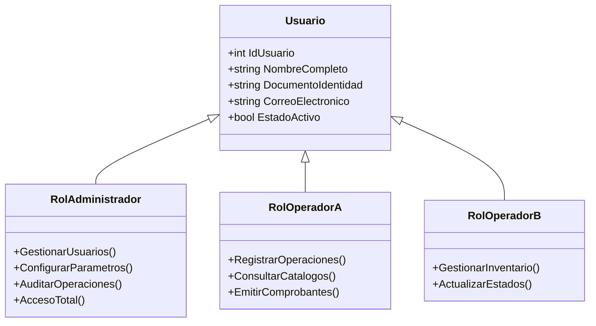
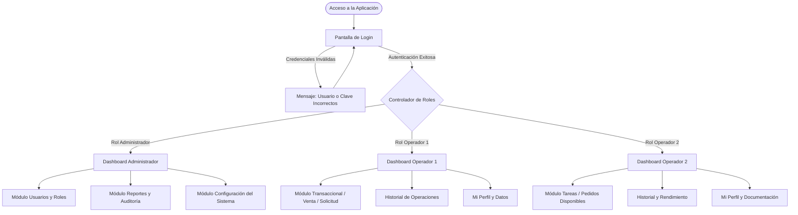
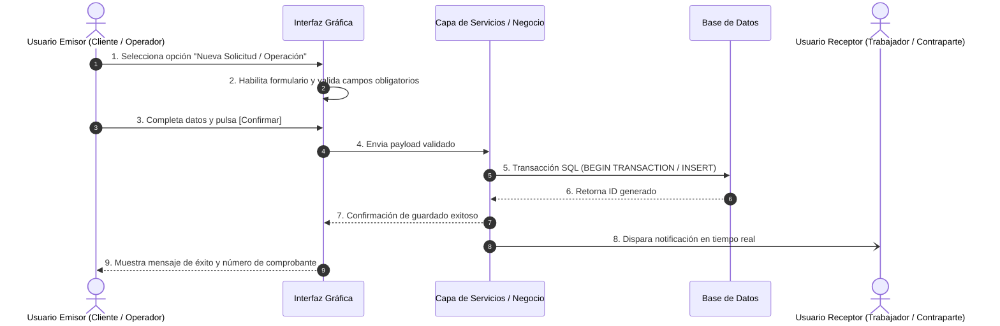

# [NOMBRE DEL PROYECTO O SISTEMA]
## Manual de Usuario y Guía de Operatoria del Sistema

---

### Metadatos Académicos / Institucionales
- **Institución:** Universidad Nacional del Nordeste (UNNE)
- **Facultad:** Facultad de Ciencias Exactas y Naturales y Agrimensura (FaCENA)
- **Carrera:** Licenciatura en Sistemas de Información
- **Asignatura:** [Ingeniería del Software II / Taller de Programación 2]
- **Ciclo Lectivo:** [Año, ej. 2026]
- **Docente a Cargo:** Prof. Juan Andrés Carruthers
- **Autores / Integrantes:**
  - [Apellido, Nombre] — D.N.I.: [XX.XXX.XXX]
  - [Apellido, Nombre] — D.N.I.: [XX.XXX.XXX]
- **Repositorio Oficial:** `[URL del Repositorio de GitHub / GitLab]`
- **Versión del Documento:** 1.0.0
- **Fecha de Emisión:** [DD/MM/AAAA]

---

## Control de Versiones

| Versión | Fecha | Autor(es) | Descripción del Cambio / Alcance |
| :---: | :---: | :---: | :--- |
| `1.0.0` | `[DD/MM/AAAA]` | `[Nombres]` | Versión inicial del manual de usuario con desglose de pantallas y flujos operativos. |

---

## Índice General

1. [Introducción y Objetivos del Manual](#1-introducción-y-objetivos-del-manual)
   - 1.1 [Propósito del Documento](#11-propósito-del-documento)
   - 1.2 [Audiencia Objetivo y Perfiles Destinatarios](#12-audiencia-objetivo-y-perfiles-destinatarios)
   - 1.3 [Convenciones Visuales y Tipográficas](#13-convenciones-visuales-y-tipográficas)
2. [Requisitos del Sistema y Puesta en Marcha](#2-requisitos-del-sistema-y-puesta-en-marcha)
   - 2.1 [Requisitos Mínimos y Recomendados de Hardware](#21-requisitos-mínimos-y-recomendados-de-hardware)
   - 2.2 [Requisitos de Software y Dependencias](#22-requisitos-de-software-y-dependencias)
   - 2.3 [Acceso Inicial y Configuración de Conexión](#23-acceso-inicial-y-configuración-de-conexión)
3. [Roles de Usuario y Matriz de Permisos](#3-roles-de-usuario-y-matriz-de-permisos)
   - 3.1 [Definición de Actores / Roles](#31-definición-de-actores--roles)
   - 3.2 [Matriz de Control de Acceso Basada en Roles (RBAC)](#32-matriz-de-control-de-acceso-basada-en-roles-rbac)
4. [Estructura General y Mapa de Navegación](#4-estructura-general-y-mapa-de-navegación)
   - 4.1 [Diagrama de Navegación de la Aplicación](#41-diagrama-de-navegación-de-la-aplicación)
   - 4.2 [Estructura del Área de Trabajo (Layout Estándar)](#42-estructura-del-área-de-trabajo-layout-estándar)
5. [Guía Operativa Detallada por Pantalla / Módulo](#5-guía-operativa-detallada-por-pantalla--módulo)
   - 5.1 [Módulo de Autenticación y Acceso](#51-módulo-de-autenticación-y-acceso)
     - 5.1.1 [Pantalla: Inicio de Sesión (Login)](#511-pantalla-inicio-de-sesión-login)
     - 5.1.2 [Pantalla: Registro de Usuario / Solicitud de Cuenta](#512-pantalla-registro-de-usuario--solicitud-de-cuenta)
     - 5.1.3 [Pantalla: Recuperación o Cambio de Contraseña](#513-pantalla-recuperación-o-cambio-de-contraseña)
   - 5.2 [Módulo Principal / Dashboard por Rol](#52-módulo-principal--dashboard-por-rol)
     - 5.2.1 [Pantalla: Panel Principal (Dashboard Operativo)](#521-pantalla-panel-principal-dashboard-operativo)
     - 5.2.2 [Pantalla: Perfil de Usuario y Documentación](#522-pantalla-perfil-de-usuario-y-documentación)
   - 5.3 [Módulo Operativo / Transaccional Primario](#53-módulo-operativo--transaccional-primario)
     - 5.3.1 [Pantalla: Búsqueda, Filtrado y Catálogo](#531-pantalla-búsqueda-filtrado-y-catálogo)
     - 5.3.2 [Pantalla: Gestión de Pedidos / Comprobantes / Formularios](#532-pantalla-gestión-de-pedidos--comprobantes--formularios)
     - 5.3.3 [Pantalla: Registro Transaccional (Venta / Cobro / Presupuesto)](#533-pantalla-registro-transaccional-venta--cobro--presupuesto)
   - 5.4 [Módulo de Mensajería, Notificaciones o Negociación](#54-módulo-de-mensajería-notificaciones-o-negociación)
     - 5.4.1 [Pantalla: Bandeja de Notificaciones y Alertas](#541-pantalla-bandeja-de-notificaciones-y-alertas)
     - 5.4.2 [Pantalla: Mensajería Interna / Intercambio de Propuestas](#542-pantalla-mensajería-interna--intercambio-de-propuestas)
   - 5.5 [Módulo de Cierre, Auditoría y Calificación](#55-módulo-de-cierre-auditoría-y-calificación)
     - 5.5.1 [Pantalla: Cierre de Sesión / Arqueo / Finalización de Trabajo](#551-pantalla-cierre-de-sesión--arqueo--finalización-de-trabajo)
     - 5.5.2 [Pantalla: Calificación (Scoring) y Feedback](#552-pantalla-calificación-scoring-y-feedback)
6. [Flujos Operativos Críticos Paso a Paso](#6-flujos-operativos-críticos-paso-a-paso)
   - 6.1 [Flujo Crítico 1: Operación Transaccional Principal](#61-flujo-crítico-1-operación-transaccional-principal)
   - 6.2 [Flujo Crítico 2: Cancelación y Manejo de Contingencias](#62-flujo-crítico-2-cancelación-y-manejo-de-contingencias)
   - 6.3 [Flujo Crítico 3: Generación de Comprobantes y Exportación](#63-flujo-crítico-3-generación-de-comprobantes-y-exportación)
7. [Manejo de Errores, Validaciones y Contingencias](#7-manejo-de-errores-validaciones-y-contingencias)
   - 7.1 [Tabla de Mensajes de Error y Solución](#71-tabla-de-mensajes-de-error-y-solución)
   - 7.2 [Reglas de Bloqueo y Políticas de Seguridad](#72-reglas-de-bloqueo-y-políticas-de-seguridad)
8. [Preguntas Frecuentes (FAQ) y Soporte Técnico](#8-preguntas-frecuentes-faq-y-soporte-técnico)
   - 8.1 [Preguntas Frecuentes](#81-preguntas-frecuentes)
   - 8.2 [Canales de Soporte y Contacto](#82-canales-de-soporte-y-contacto)

---

## 1. Introducción y Objetivos del Manual

### 1.1 Propósito del Documento
El presente **Manual de Usuario** tiene como finalidad servir de guía integral para la operación, configuración y aprovechamiento de las funcionalidades provistas por el sistema **`[NOMBRE DEL SISTEMA]`**.

Este documento establece las instrucciones paso a paso, los flujos operativos estándar, las restricciones y validaciones del negocio, y las acciones correctivas frente a posibles contingencias, garantizando una curva de aprendizaje óptima y preservando la integridad operativa y de datos.

### 1.2 Audiencia Objetivo y Perfiles Destinatarios
El manual está orientado a:
- **Operadores Finales:** Usuarios con interacción diaria en las funciones operativas primarias (ej. cajeros, vendedores, clientes, operarios).
- **Personal de Supervisión / Gestión:** Usuarios con facultades de control, auditoría, asignación y aprobación de transacciones.
- **Administradores del Sistema:** Personal técnico o gerencial a cargo de la parametrización de usuarios, permisos, catálogos y mantenimiento de datos.

### 1.3 Convenciones Visuales y Tipográficas
Para facilitar la lectura e interpretación rápida de los elementos de la interfaz, se emplean las siguientes convenciones:

- **`[Texto Entre Corchetes]`**: Representa botones, menús, pestañas o enlaces interactivos de la interfaz gráfica.
- **`Campo en Negrita`**: Indica un campo de entrada de datos (formulario o diálogo).
- **`Fuente Monoespacio`**: Denota rutas de archivos, comandos, valores literales del sistema o identificadores únicos.
- **Llamadas de Atención:**
  - > [!NOTE] Informa sobre un comportamiento predeterminado del sistema o contexto adicional.
  - > [!IMPORTANT] Señala un paso obligatorio o condición previa indispensable.
  - > [!WARNING] Alerta sobre acciones con consecuencias importantes sobre el estado del sistema.
  - > [!CAUTION] Advierte sobre operaciones irreversibles (cancelaciones, eliminaciones o cierres definitivos).

---

## 2. Requisitos del Sistema y Puesta en Marcha

### 2.1 Requisitos Mínimos y Recomendados de Hardware

| Componente | Requisito Mínimo | Requisito Recomendado |
| :--- | :--- | :--- |
| **Procesador (CPU)** | Dual Core 2.0 GHz o superior | Quad Core 2.5 GHz o superior (x64) |
| **Memoria RAM** | 4 GB | 8 GB o superior |
| **Almacenamiento Libre** | 1 GB de espacio disponible | 5 GB en disco de estado sólido (SSD) |
| **Resolución de Pantalla** | 1024 x 768 píxeles | 1920 x 1080 píxeles (Full HD) |
| **Conectividad de Red** | Conexión local LAN (100 Mbps) / Internet 5 Mbps | Conexión LAN Gigabit / Internet de banda ancha estable |

### 2.2 Requisitos de Software y Dependencias

| Componente | Especificación Técnica |
| :--- | :--- |
| **Sistema Operativo** | Windows 10 / 11 (64-bit) o Navegador Web Moderno (Chrome, Edge, Firefox actualizado) |
| **Entorno de Ejecución** | [.NET Runtime 8.0+ / Node.js 20+ / Navegador Web estándar] |
| **Motor de Base de Datos** | [SQL Server 2019+ / PostgreSQL 15+ / Supabase] |
| **Visor de Documentos** | Lector de PDF compatible para visualización e impresión de tickets/comprobantes |

### 2.3 Acceso Inicial y Configuración de Conexión
1. **Ejecución / Inicio:**
   - Para aplicaciones de escritorio: ejecutar el binario `[NombreApp].exe` o el acceso directo provisto en el escritorio.
   - Para aplicaciones web: ingresar mediante el navegador web a la dirección provista `https://[dominio-del-sistema]`.
2. **Verificación de Conectividad:**
   - El sistema validará automáticamente la conexión a la base de datos o servicio backend.
   - En caso de falla en el enlace de red, se desplegará una pantalla de alerta indicando que no se pudo establecer comunicación con el servidor.

---

## 3. Roles de Usuario y Matriz de Permisos

### 3.1 Definición de Actores / Roles



- **Administrador:** Máximo nivel jerárquico. Posee control absoluto sobre configuraciones, altas y bajas de cuentas, auditoría y reportes consolidados.
- **[Rol Operador 1 / ej. Cajero o Cliente]:** Encargado de las operaciones cotidianas de [venta / solicitud / búsqueda / contratación].
- **[Rol Operador 2 / ej. Repositor o Trabajador]:** Encargado de las tareas de [abastecimiento / postulación / ejecución del servicio].

### 3.2 Matriz de Control de Acceso Basada en Roles (RBAC)

| Módulo / Funcionalidad | [Rol Administrador] | [Rol Operador 1] | [Rol Operador 2] | [Usuario No Autenticado] |
| :--- | :---: | :---: | :---: | :---: |
| **Inicio de Sesión (Login)** | ✅ | ✅ | ✅ | ✅ |
| **Registro de Nuevo Usuario** | ✅ | ✅ | ✅ | ✅ |
| **Consulta de Catálogo / Búsqueda** | ✅ | ✅ | ✅ | ❌ / Solo lectura |
| **Creación de Solicitudes / Transacciones** | ✅ | ✅ | ❌ | ❌ |
| **Postulación / Aceptación de Tareas** | ❌ | ❌ | ✅ | ❌ |
| **Cierre de Caja / Arqueo / Confirmación** | ✅ | ✅ | ❌ | ❌ |
| **Calificación (Scoring) y Feedback** | ❌ | ✅ | ✅ | ❌ |
| **ABM de Usuarios y Permisos** | ✅ | ❌ | ❌ | ❌ |
| **Informes y Reportes Gerenciales** | ✅ | ❌ | ❌ | ❌ |

---

## 4. Estructura General y Mapa de Navegación

### 4.1 Diagrama de Navegación de la Aplicación



### 4.2 Estructura del Área de Trabajo (Layout Estándar)
La interfaz se organiza bajo un esquema ergonómico unificado:

```
+-----------------------------------------------------------------------------------+
|  [LOGO SISTEMA]      Título del Sistema / Encabezado       Usuario: [Nombre] [SALIR]|
+-------------------+---------------------------------------------------------------+
|  MENÚ LATERAL     |  BARRA DE NAVEGACIÓN SUPERIOR (Breadcrumbs / Acciones)        |
|  ---------------- |---------------------------------------------------------------+
|  [*] Inicio       |                                                               |
|  [*] Operaciones  |                     ÁREA DE CONTENIDO PRINCIPAL               |
|  [*] Catálogo     |                                                               |
|  [*] Historial    |  (Formularios, Grillas de Datos, Paneles Informativos, Modales)|
|  [*] Mi Perfil    |                                                               |
|  [*] Reportes     |                                                               |
|  [*] Configuración|                                                               |
+-------------------+---------------------------------------------------------------+
|  BARRA DE ESTADO  |  Estado de Red: En Línea  |  Caja/Turno: #123  |  v1.0.0      |
+-----------------------------------------------------------------------------------+
```

---

## 5. Guía Operativa Detallada por Pantalla / Módulo

---

### 5.1 Módulo de Autenticación y Acceso

#### 5.1.1 Pantalla: Inicio de Sesión (Login)

```
+---------------------------------------------------------------------+
|                      [LOGO INSTITUCIONAL / SISTEMA]                 |
|                             INICIAR SESIÓN                          |
|                                                                     |
|    Usuario / DNI / Email:  [________________________________]       |
|    Contraseña:             [********************************] [OJO] |
|                                                                     |
|    [ ] Recordar usuario                   [¿Olvidó su contraseña?]  |
|                                                                     |
|                 [   INGRESAR AL SISTEMA   ]                         |
|                                                                     |
|    ¿No tiene cuenta aún? [Registrarse aquí]                         |
+---------------------------------------------------------------------+
```

- **Propósito:** Permitir la autenticación segura del usuario mediante validación criptográfica de identidad y carga del contexto de sesión correspondiente a su rol.
- **Acceso:** Público (usuarios registrados previamente).
- **Precondiciones:** El sistema debe contar con conexión activa al repositorio de datos.

##### Controles y Campos de la Pantalla

| Elemento / Campo | Tipo de Control | Obligatorio | Formato / Validación | Descripción |
| :--- | :--- | :---: | :--- | :--- |
| **Usuario / DNI** | Cuadro de texto | Sí | Alfanumérico o numérico (8-10 caracteres) | Identificador único de la cuenta en el sistema. |
| **Contraseña** | Cuadro de contraseña | Sí | Mínimo 6-8 caracteres | Clave secreta (encriptada con algoritmo seguro). |
| **Mostrar Clave** | Botón icono (Ojo) | No | Booleano | Alterna la visibilidad de los caracteres ingresados. |
| **[Ingresar al Sistema]**| Botón de acción | Sí | Clic de mouse / Tecla Enter | Dispara el proceso de autenticación. |
| **[Registrarse aquí]** | Enlace / Botón | No | Clic de mouse | Redirige al asistente de registro de nueva cuenta. |

##### Procedimiento Operativo Paso a Paso
1. Ingrese su identificador de usuario o documento en el campo **Usuario / DNI**.
2. Escriba su contraseña secreta en el campo **Contraseña**.
3. Presione la tecla `[Enter]` o haga clic en el botón `[Ingresar al Sistema]`.
4. El sistema verificará los datos en la base de datos:
   - **Caso Exitoso:** Se cargará la sesión del usuario, se validarán sus permisos y se abrirá el Dashboard correspondiente a su rol.
   - **Caso Fallido:** Se mantendrá en la pantalla y se mostrará un mensaje descriptivo en color rojo: `"Usuario o contraseña incorrectos. Verifique sus credenciales"`.

---

#### 5.1.2 Pantalla: Registro de Usuario / Solicitud de Cuenta

```
+---------------------------------------------------------------------+
|                         REGISTRO DE USUARIO                         |
|                                                                     |
|  Tipo de Cuenta:  ( ) Operador/Cliente   ( ) Técnico/Trabajador     |
|                                                                     |
|  Nombre Completo: [________________________________]                |
|  DNI / CUIT:      [________________]  Teléfono: [________________]  |
|  Correo Electrónico: [________________________________]             |
|  Contraseña:      [****************]  Confirmar: [***************]  |
|                                                                     |
|  DOCUMENTACIÓN REQUERIDA:                                           |
|  - Foto DNI Frente:    [Adjuntar Archivo...] (PDF/JPG/PNG)          |
|  - Foto DNI Dorso:     [Adjuntar Archivo...] (PDF/JPG/PNG)          |
|  - Certificado Extra:  [Adjuntar Archivo...] (Opcional)             |
|                                                                     |
|            [ Cancelar ]              [ Confirmar Registro ]         |
+---------------------------------------------------------------------+
```

- **Propósito:** Registrar un nuevo usuario en la base de datos con validación de edad mínima, unicidad de documento/correo y almacenamiento seguro de archivos respaldatorios.
- **Precondiciones:** Documento y correo electrónico no deben encontrarse previamente registrados en el sistema.

##### Procedimiento Operativo Paso a Paso
1. Seleccione el **Tipo de Cuenta** o perfil a registrar.
2. Complete la totalidad de los datos personales requeridos en los campos correspondientes.
3. Adjunte los archivos obligatorios haciendo clic en `[Adjuntar Archivo...]`.
4. Haga clic en `[Confirmar Registro]`.
5. El sistema validará:
   - Que ningún campo obligatorio haya quedado vacío.
   - Que las contraseñas coincidan exactamente.
   - Que el formato de correo electrónico sea válido.
   - Que el tamaño y formato de los archivos adjuntos se encuentren dentro de los límites admitidos (ej. máximo 5 MB en formato JPG, PNG o PDF).
6. Al completarse con éxito, el sistema notificará: `"Registro completado con éxito. Ahora puede iniciar sesión"`.

---

### 5.2 Módulo Principal / Dashboard por Rol

#### 5.2.1 Pantalla: Panel Principal (Dashboard Operativo)

```
+---------------------------------------------------------------------+
| [INICIO]  Bienvenido/a: [Nombre del Usuario] | Rol: [Rol Actual]     |
+---------------------------------------------------------------------+
|  TARJETAS DE RESUMEN:                                               |
|  +-------------------+  +-------------------+  +-----------------+  |
|  | Transacciones Hoy |  | Tareas Pendientes |  | Calificación / |  |
|  |      [ $ XX.XXX ] |  |      [  XX  ]     |  | Estado: [ 4.8 ] |  |
|  +-------------------+  +-------------------+  +-----------------+  |
|                                                                     |
|  ACCESOS DIRECTOS PRINCIPALES:                                      |
|  [ + Nueva Operación ]  [ Consultar Historial ]  [ Ver Catálogo ]   |
|                                                                     |
|  TABLA DE ACTIVIDAD RECIENTE:                                       |
|  | Código | Fecha/Hora | Descripción / Contraparte | Monto | Estado |
|  |--------|------------|---------------------------|-------|--------|
|  | #1001  | 10:15 hs   | Mantenimiento Preventivo  | $5000 | Concl. |
|  | #1002  | 11:30 hs   | Instalación Eléctrica     | $8200 | Pend.  |
+---------------------------------------------------------------------+
```

- **Propósito:** Brindar una visión panorámica e interactiva del estado actual de las actividades, accesos rápidos a las funciones operativas más recurrentes y resumen de indicadores clave (KPIs).
- **Comportamiento según Rol:** El contenido de las tarjetas y la visibilidad de los accesos directos se adapta automáticamente al rol del usuario en sesión.

---

### 5.3 Módulo Operativo / Transaccional Primario

#### 5.3.1 Pantalla: Búsqueda, Filtrado y Catálogo

```
+---------------------------------------------------------------------+
|                       CATÁLOGO Y BÚSQUEDA                           |
|                                                                     |
|  Buscar por Nombre/Código: [____________________]  [ Buscar ]       |
|  Filtrar por Rubro/Categoría: [ Todos los Rubros     v ]            |
|  Ordenar por: [ Mejor Calificación / Menor Precio    v ]            |
|                                                                     |
|  RESULTADOS OBTENIDOS:                                              |
|  +---------------------------------------------------------------+  |
|  | [FOTO] Nombre: Juan Pérez  | Oficio: Plomero | Puntos: [5.0]  |  |
|  |        Certificaciones: Matrícula Oficial A-102               |  |
|  |        [ Ver Perfil Completo ]          [ Iniciar Solicitud ] |  |
|  +---------------------------------------------------------------+  |
|  | [FOTO] Nombre: Carlos Ruiz | Oficio: Electricista | Pts: [4.7]|  |
|  |        Certificaciones: Certificado Policía Verificado        |  |
|  |        [ Ver Perfil Completo ]          [ Iniciar Solicitud ] |  |
|  +---------------------------------------------------------------+  |
+---------------------------------------------------------------------+
```

- **Propósito:** Permitir al usuario explorar los ítems, servicios o profesionales disponibles en la plataforma mediante criterios de filtrado multidimensional y ordenamiento jerárquico.
- **Acciones:**
  - `[Ver Perfil Completo]`: Abre una vista modal con el detalle exhaustivo, documentación y opiniones previas.
  - `[Iniciar Solicitud / Contactar]`: Despliega el canal de comunicación o el formulario de contratación directa.

---

#### 5.3.2 Pantalla: Gestión de Pedidos / Comprobantes / Formularios

```
+---------------------------------------------------------------------+
|                    NUEVA SOLICITUD / PUBLICACIÓN                    |
|                                                                     |
|  Rubro / Tipo de Servicio:  [ Seleccione Rubro...            v ]    |
|  Nivel de Urgencia:         ( ) Baja    (*) Media    ( ) Alta       |
|                                                                     |
|  Título o Resumen Breve:    [________________________________]      |
|                                                                     |
|  Descripción Detallada del Requerimiento o Problema:                |
|  +---------------------------------------------------------------+  |
|  | Describa aquí con precisión la tarea, materiales necesarios,  |  |
|  | dimensiones o consideraciones de horario...                   |  |
|  +---------------------------------------------------------------+  |
|                                                                     |
|  Dirección / Ubicación:     [________________________________]      |
|  Fecha Estimada Preferente: [ DD/MM/AAAA ]                          |
|                                                                     |
|                   [ Cancelar ]        [ Publicar / Enviar ]         |
+---------------------------------------------------------------------+
```

##### Validaciones y Criterios de Aceptación
- El botón `[Publicar / Enviar]` permanecerá inactivo (deshabilitado) hasta que el usuario complete todos los campos obligatorios.
- La descripción debe contar con una longitud mínima de caracteres (ej. 20 caracteres) para garantizar claridad.
- Si el usuario selecciona `[Cancelar]`, el sistema solicitará confirmación antes de descartar los datos cargados.

---

#### 5.3.3 Pantalla: Registro Transaccional (Venta / Cobro / Presupuesto Formal)

```
+---------------------------------------------------------------------+
|                   FORMALIZACIÓN DE PROPUESTA / PAGO                 |
|                                                                     |
|  Identificador de Operación: #PROP-2026-094                         |
|  Contraparte / Cliente: Juan Pérez (DNI: 43.064.294)                |
|                                                                     |
|  Monto Total Acordado ($):   [ 15000.00          ]                  |
|  Fecha y Hora Programada:    [ 15/10/2026  14:00 ]                  |
|  Materiales Incluidos:       [ Repuestos y tornillería básica  ]    |
|  Método de Cobro / Pago:     [ Efectivo / Transferencia     v ]     |
|                                                                     |
|  CONDICIONES DE CONTRATACIÓN:                                       |
|  - El importe acordado es final y no admite recargos imprevistos.    |
|  - La cancelación sin cargo rige hasta 1 hora antes de lo pactado.  |
|                                                                     |
|                 [ Rechazar ]          [ Confirmar Operación ]       |
+---------------------------------------------------------------------+
```

- **Propósito:** Formalizar el acuerdo vinculante entre ambas partes, fijando el precio, fecha, horario y alcance de los materiales.
- **Postcondición:** Al confirmarse, el estado del acuerdo pasa a `Confirmada` / `En Curso`, se genera el comprobante digital y se habilitan los datos de contacto directo.

---

### 5.4 Módulo de Mensajería, Notificaciones o Negociación

#### 5.4.1 Pantalla: Mensajería Interna y Chat de Negociación

```
+---------------------------------------------------------------------+
| CHAT DE NEGOCIACIÓN: Solicitud #1001       Estado: En Negociación   |
+---------------------------------------------------------------------+
| [Juan Pérez - 10:20] Hola, necesito consultar disponibilidad técnica.|
| [Carlos Ruiz - 10:22] Buen día, puedo asistir hoy a las 15:00 hs.   |
| [Juan Pérez - 10:23] Perfecto, ¿cuál sería el costo estimado?       |
| [Carlos Ruiz - 10:25] [PROPUESTA ENVIADA: $15.000 - Ver detalle]    |
+---------------------------------------------------------------------+
| Escribir mensaje: [_________________________________] [ Enviar ]    |
|                                                                     |
| ACCIONES DISPONIBLES:                                               |
| [ Enviar Propuesta Formal ]   [ Aceptar Propuesta ]  [ Cancelar ]   |
+---------------------------------------------------------------------+
```

- **Manejo de Estados en el Chat:**
  - El intercambio de mensajes es en tiempo real.
  - Cuando una de las partes formaliza una propuesta, aparece en el cuerpo de la conversación una tarjeta estructurada.
  - Los datos de contacto directo (número telefónico y correo) se encuentran enmascarados y solo se revelan una vez que el contrato es oficialmente `Confirmado`.

---

### 5.5 Módulo de Cierre, Auditoría y Calificación

#### 5.5.1 Pantalla: Cierre de Sesión / Arqueo / Finalización de Trabajo

```
+---------------------------------------------------------------------+
|                     FINALIZACIÓN DE CONTRATO / SERVICIO             |
|                                                                     |
|  Contrato N°: #1001          Fecha de Ejecución: 15/10/2026         |
|  Profesional / Empleado: Carlos Ruiz                                |
|  Monto Facturado: $15.000    Estado Actual: Pendiente de Cierre     |
|                                                                     |
|  Confirmación de Cumplimiento:                                      |
|  [X] Declaro que el trabajo ha sido recibido conforme a lo pactado. |
|                                                                     |
|              [ Volver ]            [ Confirmar Finalización ]       |
+---------------------------------------------------------------------+
```

- **Regla del Negocio:** Esta opción únicamente se habilita una vez transcurrido el tiempo programado del servicio o cuando el operador confirma la entrega.

---

#### 5.5.2 Pantalla: Calificación (Scoring) y Feedback

```
+---------------------------------------------------------------------+
|                       VALORACIÓN DEL SERVICIO                       |
|                                                                     |
|  Califique el desempeño de: [Nombre del Prestador / Cliente]        |
|                                                                     |
|  Puntuación General:     ( ) 1   ( ) 2   ( ) 3   ( ) 4   (*) 5 Estrellas |
|                                                                     |
|  Comentario / Reseña Pública (Máximo 500 caracteres):               |
|  +---------------------------------------------------------------+  |
|  | Excelente servicio, puntual, prolijo y muy profesional.        |  |
|  | Muy recomendable para futuros trabajos.                       |  |
|  +---------------------------------------------------------------+  |
|  Caracteres restantes: 410 / 500                                    |
|                                                                     |
|                    [ Omitir ]          [ Guardar Valoración ]       |
+---------------------------------------------------------------------+
```

##### Reglas de Validación
- La puntuación debe estar comprendida estrictamente en el rango entero de `1` a `5`.
- El comentario es obligatorio y no puede exceder los `500` caracteres.
- Una vez registrada la calificación, el sistema recalcula el promedio general del usuario mediante una operación segura y la interfaz de puntuación queda bloqueada para evitar votos duplicados (restricción `UNIQUE`).

---

## 6. Flujos Operativos Críticos Paso a Paso

### 6.1 Flujo Crítico 1: Operación Transaccional Principal (Camino Feliz)



1. **Inicio de la Operación:** El usuario hace clic en el botón de acción principal de la pantalla.
2. **Carga de Datos:** Se completan los datos requeridos respetando las restricciones de tipo y longitud.
3. **Validación de la Interfaz:** La interfaz bloquea el envío hasta verificar que las precondiciones se satisfacen.
4. **Persistencia Transaccional:** La capa de negocio ejecuta la transacción garantizando atomicidad (ACID).
5. **Notificación y Actualización:** Se refresca la grilla de actividades y se notifica a la contraparte interesada.

---

### 6.2 Flujo Crítico 2: Cancelación y Manejo de Contingencias

> [!WARNING]
> **Política Temporal de Cancelación:** Toda operación confirmada únicamente podrá cancelarse si existe una anticipación superior a **1 hora** respecto de la fecha/horario programado. De lo contrario, el botón de cancelación se inhabilitará automáticamente.

1. El usuario accede al detalle de la operación confirmada.
2. Presiona el botón `[Cancelar Operación]`.
3. El sistema evalúa:
   $$\Delta t = \text{Fecha/Hora Acordada} - \text{Fecha/Hora Actual}$$
4. **Si $\Delta t > 1\text{ hora}$:**
   - Se despliega el cuadro de confirmación: `"¿Está seguro de que desea cancelar la operación confirmada?"`.
   - El usuario selecciona un motivo del desplegable y pulsa `[Aceptar Cancelación]`.
   - El estado de la operación cambia a `Cancelada`.
   - Se notifica a la contraparte y se libera el registro.
5. **Si $\Delta t \le 1\text{ hora}$:**
   - La acción es rechazada.
   - El sistema emite la alerta: `"La operación no puede cancelarse con menos de 1 hora de anticipación. Por favor comuníquese con Soporte Técnico"`.

---

## 7. Manejo de Errores, Validaciones y Contingencias

### 7.1 Tabla de Mensajes de Error y Solución Operativa

| Código / Alerta Visual | Causa Raíz Probable | Solución / Acción del Usuario |
| :--- | :--- | :--- |
| `"Credenciales Incorrectas"` | El usuario o la contraseña ingresada no coinciden con la base de datos. | Reintentar respetando mayúsculas y minúsculas. Usar la opción de restablecimiento de contraseña. |
| `"Campos Obligatorios Incompletos"` | Se intentó guardar o enviar un formulario con campos vacíos. | Revisar los campos marcados en rojo con asterisco (*) y completarlos antes de reenviar. |
| `"Formato de Archivo No Permitido"` | Se intentó adjuntar un archivo con extensión distinta a `.pdf`, `.jpg` o `.png`. | Convertir el archivo a formato JPG o PDF con tamaño menor a 5 MB y reintentar. |
| `"Operación Fuera de Plazo"` | Se intentó cancelar una operación con menos de 60 minutos de anticipación. | La operación debe gestionarse a través del canal de soporte administrativo. |
| `"Error de Conexión con el Servidor"` | Caída de red local, corte de internet o microcorte en el servidor de base de datos. | Verificar la conexión local a internet. Si persiste, aguardar unos minutos y reintentar. |
| `"Registro Duplicado / Ya Calificado"` | Se intentó calificar una transacción ya evaluada con anterioridad. | La operación ya fue registrada; no es necesario realizar una nueva acción. |

---

## 8. Preguntas Frecuentes (FAQ) y Soporte Técnico

### 8.1 Preguntas Frecuentes
- **¿Puedo modificar mis datos personales una vez creada la cuenta?**  
  Sí, accediendo a la sección `[Mi Perfil]` podrá actualizar sus datos de contacto y subir nueva documentación respaldatoria cuando sea necesario.
- **¿Qué sucede si cierro la aplicación sin finalizar una operación?**  
  Las operaciones no confirmadas permanecen en estado borrador o son descartadas para preservar la integridad transaccional de la base de datos.
- **¿Dónde puedo descargar los comprobantes o resúmenes de operaciones?**  
  En el módulo `[Historial]` o `[Mis Pedidos]`, cada registro cuenta con un botón directo `[Descargar PDF]` o `[Imprimir Comprobante]`.

### 8.2 Canales de Soporte y Contacto
Ante incidentes técnicos, bloqueos no resueltos o consultas administrativas:
- **Correo Institucional / Soporte:** `soporte@[dominiodelsistema].com`
- **Mesa de Ayuda:** Lunes a Viernes de 08:00 a 18:00 hs
- **Repositorio y Reporte de Bugs:** `[URL del Repositorio]/issues`

