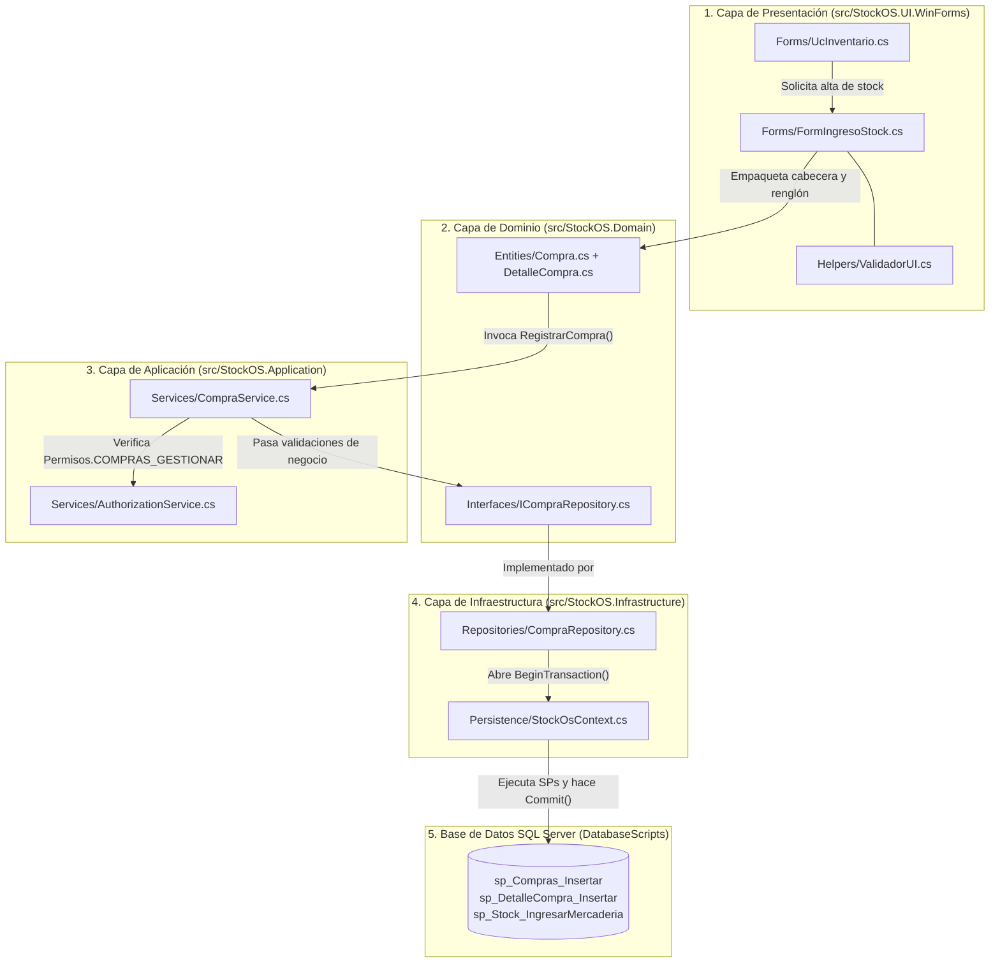
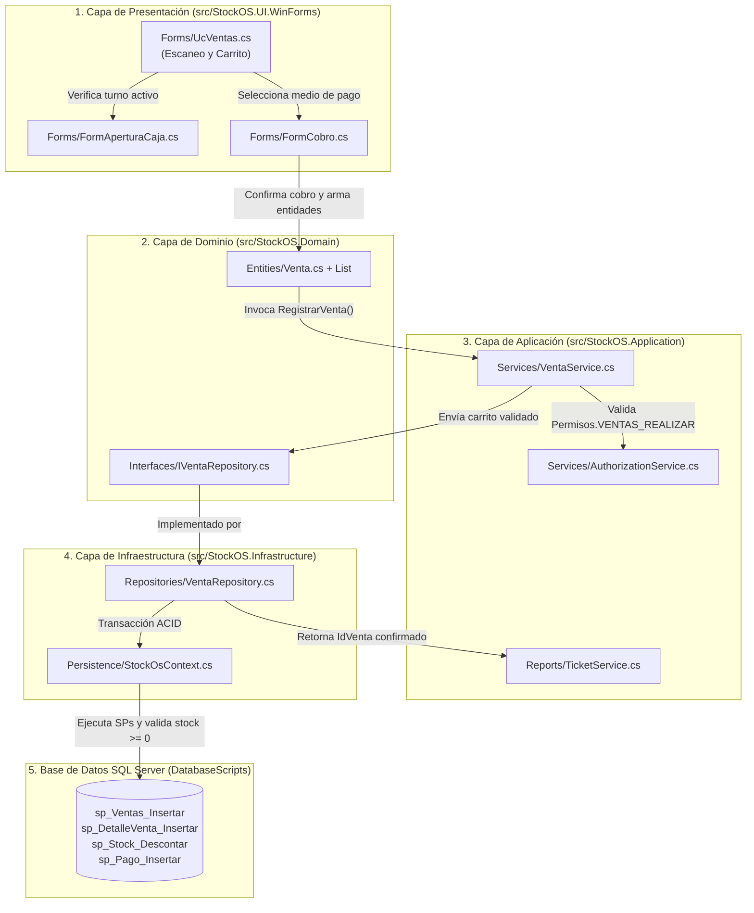

# INFORME TÉCNICO DE ARQUITECTURA Y TRAZABILIDAD DE DATOS: COMPRAS, VENTAS Y COPIAS DE SEGURIDAD

**Proyecto:** StockOS — Sistema de Punto de Venta (POS) y Administración Integral de Stock Comercial  
**Arquitectura:** N-Tier (4 Capas Desacopladas) sobre Microsoft .NET 8 y SQL Server 2022  
**Fecha de Emisión:** Noviembre 2026  

---

## 1. Resumen Ejecutivo y Estructura General del Proyecto

El sistema **StockOS** implementa una **Arquitectura en 4 Capas (Clean / Layered Architecture)** con inversión de dependencias configurada en el punto de entrada ([`Program.cs`](file:///c:/Proyecto/StockOS/src/StockOS.UI.WinForms/Program.cs)). El objetivo central de esta estructura es garantizar que la interfaz gráfica nunca acceda de manera directa a las tablas de SQL Server, obligando a que todo dato atraviese controles de permisos, validaciones de negocio y bloques transaccionales atómicos (`ACID`).

### 1.1. Distribución de Directorios y Responsabilidades

```text
C:\Proyecto\StockOS\
│
├── 📁 src\
│   ├── 📦 StockOS.UI.WinForms\          --> 1. CAPA DE PRESENTACIÓN (Interfaz Gráfica y Eventos)
│   │   ├── 📁 Forms\                    --> Ventanas (Form*) y Controles de Usuario (Uc*)
│   │   ├── 📁 Helpers\                  --> Validadores de entrada de teclado (ValidadorUI.cs)
│   │   └── 📄 Program.cs                --> Inyección de Dependencias y ciclo de vida de sesión
│   │
│   ├── 📦 StockOS.Application\          --> 2. CAPA DE APLICACIÓN (Lógica de Negocio y Seguridad)
│   │   ├── 📁 Services\                 --> Reglas de negocio, permisos y estado de sesión
│   │   └── 📁 Reports\                  --> Generación documental y emisión de tickets PDF
│   │
│   ├── 📦 StockOS.Domain\               --> 3. CAPA DE DOMINIO (Núcleo y Contratos Puros)
│   │   ├── 📁 Entities\                 --> Modelos de negocio (Producto, Compra, Venta, etc.)
│   │   ├── 📁 Enums\                    --> Enumeraciones (RolUsuario, Permisos, PeriodoBackup)
│   │   ├── 📁 Interfaces\               --> Contratos de servicios y repositorios (I*Repository)
│   │   └── 📁 DTOs\                     --> Objetos de transferencia para reportes
│   │
│   └── 📦 StockOS.Infrastructure\       --> 4. CAPA DE ACCESO A DATOS (Persistencia SQL Server)
│       ├── 📁 Persistence\              --> Contexto EF Core (StockOsContext.cs)
│       ├── 📁 Repositories\             --> Ejecución transaccional de Procedimientos Almacenados
│       └── 📁 Services\                 --> Administración física del motor (BackupService.cs)
│
└── 📁 DatabaseScripts\                  --> 5. CAPA DE BASE DE DATOS (Motor Relacional SQL Server)
    ├── 📄 00_CreacionCompleta.sql       --> Tablas, restricciones CHECK/UNIQUE y Stored Procedures
    ├── 📄 07_Correcciones_Sps_Auditoria.sql
    ├── 📄 08_Migracion_Usuarios.sql
    ├── 📄 09_Lote_Datos_Masivos_50Usuarios_2000Compras_2000Ventas.sql
    ├── 📄 Backup_Programado_StockOS.ps1
    └── 📄 Backup_Programado_StockOS.bat
```

---

## 2. Flujo Arquitectónico de la COMPRA de Productos (Abastecimiento)

El circuito de compra permite abastecer el inventario mediante facturas o remitos de proveedores, actualizando en un único paso contable el historial de compras y las existencias físicas de la sucursal.

### 2.1. Diagrama de Recorrido del Dato (Compra)



### 2.2. Trazabilidad Archivo por Archivo en el Proceso de Compra

| Orden | Carpeta | Archivo y Función | ¿Qué hace con los datos y por qué pasa por aquí? |
| :---: | :--- | :--- | :--- |
| **1** | `src/StockOS.UI.WinForms/Forms/` | [`UcInventario.cs`](file:///c:/Proyecto/StockOS/src/StockOS.UI.WinForms/Forms/UcInventario.cs) | Punto de partida visual desde el módulo de inventario. Al pulsar el botón de ingreso de mercadería, instancia y abre el formulario modal de carga. |
| **2** | `src/StockOS.UI.WinForms/Forms/` | [`FormIngresoStock.cs`](file:///c:/Proyecto/StockOS/src/StockOS.UI.WinForms/Forms/FormIngresoStock.cs) (`BuscarProductoPorCodigo` y `BtnGuardar_Click`) | Captura el código de barras, el proveedor, la cantidad comprada, el costo unitario y el margen de ganancia. Utiliza [`ValidadorUI.cs`](file:///c:/Proyecto/StockOS/src/StockOS.UI.WinForms/Helpers/ValidadorUI.cs) para impedir caracteres inválidos y calcula en vivo el nuevo precio de venta sugerido. |
| **3** | `src/StockOS.Domain/Entities/` | [`Compra.cs`](file:///c:/Proyecto/StockOS/src/StockOS.Domain/Entities/Compra.cs) y [`DetalleCompra.cs`](file:///c:/Proyecto/StockOS/src/StockOS.Domain/Entities/DetalleCompra.cs) | Encapsula los valores ingresados en la pantalla dentro de objetos estructurados del dominio (cabecera con fecha, proveedor, empleado y sucursal; detalle con producto, cantidad y precio de costo). |
| **4** | `src/StockOS.Application/Services/` | [`CompraService.cs`](file:///c:/Proyecto/StockOS/src/StockOS.Application/Services/CompraService.cs) (`RegistrarCompra`) | **Filtro de Seguridad y Negocio:** Consulta a [`AuthorizationService.cs`](file:///c:/Proyecto/StockOS/src/StockOS.Application/Services/AuthorizationService.cs) para verificar que el usuario en [`SesionActual.cs`](file:///c:/Proyecto/StockOS/src/StockOS.Application/Services/SesionActual.cs) posea el permiso `COMPRAS_GESTIONAR`. Valida que la cantidad y el precio unitario sean estrictamente mayores a cero antes de tocar la base de datos. |
| **5** | `src/StockOS.Infrastructure/Repositories/` | [`CompraRepository.cs`](file:///c:/Proyecto/StockOS/src/StockOS.Infrastructure/Repositories/CompraRepository.cs) (`RegistrarCompra`) | **Control Transaccional:** Abre una transacción explícita en [`StockOsContext.cs`](file:///c:/Proyecto/StockOS/src/StockOS.Infrastructure/Persistence/StockOsContext.cs) (`BeginTransaction`). Pasa por este archivo para asegurar **atomicidad**: si falla el alta del detalle o la suma del stock, ejecuta `Rollback()` para no dejar comprobantes huérfanos. |
| **6** | `DatabaseScripts/` | [`00_CreacionCompleta.sql`](file:///c:/Proyecto/StockOS/DatabaseScripts/00_CreacionCompleta.sql) | **Persistencia Relacional:** Ejecuta en secuencia: <br>1. `sp_Compras_Insertar` (tabla `compra`).<br>2. `sp_DetalleCompra_Insertar` (tabla `detalle_compra`).<br>3. `sp_Stock_IngresarMercaderia` (incrementa `stock_actual` en `stock_sucursal`). |

---

## 3. Flujo Arquitectónico de la VENTA de Productos (Punto de Venta - POS)

El circuito de venta es la operación crítica del comercio minorista. Articula la validación de existencias en tiempo real, la obligatoriedad de una sesión de caja abierta, el descuento atómico de stock, el registro del pago y la emisión del ticket fiscal en PDF.

### 3.1. Diagrama de Recorrido del Dato (Venta)



### 3.2. Trazabilidad Archivo por Archivo en el Proceso de Venta

| Orden | Carpeta | Archivo y Función | ¿Qué hace con los datos y por qué pasa por aquí? |
| :---: | :--- | :--- | :--- |
| **1** | `src/StockOS.UI.WinForms/Forms/` | [`UcVentas.cs`](file:///c:/Proyecto/StockOS/src/StockOS.UI.WinForms/Forms/UcVentas.cs) (`BuscarYAgregarProducto`) | Al escanear un código de barras, consulta a [`ProductoService.cs`](file:///c:/Proyecto/StockOS/src/StockOS.Application/Services/ProductoService.cs) y [`StockService.cs`](file:///c:/Proyecto/StockOS/src/StockOS.Application/Services/StockService.cs) para verificar que el artículo exista, esté activo y cuente con stock disponible en la sucursal antes de sumarlo al carrito visual. |
| **2** | `src/StockOS.UI.WinForms/Forms/` | [`UcVentas.cs`](file:///c:/Proyecto/StockOS/src/StockOS.UI.WinForms/Forms/UcVentas.cs) (`btnCobrar_Click`) y [`FormCobro.cs`](file:///c:/Proyecto/StockOS/src/StockOS.UI.WinForms/Forms/FormCobro.cs) | Comprueba en [`SesionActual.cs`](file:///c:/Proyecto/StockOS/src/StockOS.Application/Services/SesionActual.cs) que el cajero tenga una sesión de caja abierta (`IdCajaSesion`). Luego abre `FormCobro.cs` para elegir el método de pago (*Efectivo, Débito, Crédito o Mercado Pago*) y calcular el vuelto. |
| **3** | `src/StockOS.Domain/Entities/` | [`Venta.cs`](file:///c:/Proyecto/StockOS/src/StockOS.Domain/Entities/Venta.cs) y [`DetalleVenta.cs`](file:///c:/Proyecto/StockOS/src/StockOS.Domain/Entities/DetalleVenta.cs) | Convierte las filas de la grilla en una cabecera `Venta` y una lista `List<DetalleVenta>`. **Por qué es clave:** Guarda el `PrecioUnitarioHistorico` vigente en ese instante para que futuros aumentos de precios no alteren tickets pasados. |
| **4** | `src/StockOS.Application/Services/` | [`VentaService.cs`](file:///c:/Proyecto/StockOS/src/StockOS.Application/Services/VentaService.cs) (`RegistrarVenta`) | **Blindaje de Reglas de Negocio:** Verifica junto a [`AuthorizationService.cs`](file:///c:/Proyecto/StockOS/src/StockOS.Application/Services/AuthorizationService.cs) el permiso `VENTAS_REALIZAR`. Audita que la lista de detalles no esté vacía, que cada cantidad sea mayor a cero y que la sucursal y medio de pago sean válidos. |
| **5** | `src/StockOS.Infrastructure/Repositories/` | [`VentaRepository.cs`](file:///c:/Proyecto/StockOS/src/StockOS.Infrastructure/Repositories/VentaRepository.cs) (`RegistrarVenta`) | **Ejecución Transaccional:** Abre una transacción en [`StockOsContext.cs`](file:///c:/Proyecto/StockOS/src/StockOS.Infrastructure/Persistence/StockOsContext.cs) para coordinar la inserción en 4 tablas. Si un producto se quedó sin stock un milisegundo antes en otra caja, captura la excepción de SQL Server y ejecuta `Rollback()`, anulando toda la operación de forma limpia. |
| **6** | `DatabaseScripts/` | [`00_CreacionCompleta.sql`](file:///c:/Proyecto/StockOS/DatabaseScripts/00_CreacionCompleta.sql) y [`07_Correcciones_Sps_Auditoria.sql`](file:///c:/Proyecto/StockOS/DatabaseScripts/07_Correcciones_Sps_Auditoria.sql) | **Motor SQL Server:** Ejecuta dentro de la misma transacción:<br>1. `sp_Ventas_Insertar` (tabla `venta`).<br>2. `sp_DetalleVenta_Insertar` (tabla `detalle_venta`).<br>3. `sp_Stock_Descontar` (descuenta en `stock_sucursal` validando `stock_actual >= CantidadAVender`).<br>4. `sp_Pago_Insertar` (registra el cobro en `pago` para el arqueo de caja). |
| **7** | `src/StockOS.Application/Reports/` | [`TicketService.cs`](file:///c:/Proyecto/StockOS/src/StockOS.Application/Reports/TicketService.cs) (`GenerarTicketPdf`) | Confirmado el `Commit()` en base de datos, toma los datos del comercio desde [`ConfiguracionService.cs`](file:///c:/Proyecto/StockOS/src/StockOS.Application/Services/ConfiguracionService.cs) (`appsettings.json`) y construye el comprobante PDF con desglose de IVA e importe total. |

### 3.3. Ciclo de Vida de la Vista de Ventas (`UcVentas`), Persistencia de Caja vs. Volatilidad del Carrito al Cambiar de Módulo

Cuando un operador abre la caja, carga productos en la grilla de venta sin finalizar el cobro, navega hacia otro módulo del sistema (por ejemplo **Inventario** para ingresar stock o **Usuarios**) y luego regresa a **Ventas**, se observa que **la sesión de caja continúa abierta, pero el carrito pendiente de cobro se reinicia vacío**. Este comportamiento responde directamente al diseño arquitectónico de inyección de dependencias y navegación de vistas:

1. **Limpieza del contenedor principal en [`FormInicio.cs`](file:///c:/Proyecto/StockOS/src/StockOS.UI.WinForms/Forms/FormInicio.cs) (`CambiarVista`):**
   - Al seleccionar cualquier pestaña en la barra inferior (`dockPanel`), el método `CambiarVista(string nombreVista)` ejecuta `pnlContenedor.Controls.Clear()`, desmontando el control de usuario activo de la interfaz gráfica.
   - Al volver a seleccionar `"Ventas"`, invoca `_serviceProvider.GetRequiredService<UcVentas>()`.
2. **Tiempo de vida `Transient` en [`Program.cs`](file:///c:/Proyecto/StockOS/src/StockOS.UI.WinForms/Program.cs):**
   - El control [`UcVentas`](file:///c:/Proyecto/StockOS/src/StockOS.UI.WinForms/Forms/UcVentas.cs) está registrado en el contenedor de Inyección de Dependencias mediante `services.AddTransient<UcVentas>()`.
   - El ciclo de vida `Transient` instruye al proveedor de servicios a **instanciar un objeto nuevo (`new UcVentas(...)`) en cada solicitud**, en lugar de conservar la instancia previa en memoria durante la sesión (`Scoped` o caché de vista).
3. **Almacenamiento en memoria local del control (`UcVentas.cs`):**
   - Mientras la venta no ha sido cobrada, los renglones cargados residen exclusivamente en estructuras en memoria propias de esa instancia visual de [`UcVentas.cs`](file:///c:/Proyecto/StockOS/src/StockOS.UI.WinForms/Forms/UcVentas.cs): las filas de `dgvTicket.Rows` y los campos privados `_subtotalVenta`, `_descuentoTotal`, `_totalFinal` e `_ivaProductos`.
   - En cambio, **la apertura de caja** sí persiste al cambiar de pantalla porque su estado se almacena en la tabla `caja_sesion` de SQL Server y en la propiedad estática de sesión [`SesionActual.IdCajaSesionActual`](file:///c:/Proyecto/StockOS/src/StockOS.Application/Services/SesionActual.cs).
4. **Propósito de Integridad de Stock y Precios:**
   - Al recrear `UcVentas` tras pasar por módulos como **Inventario** (donde pudo haberse modificado el precio de venta, desactivado un producto o alterado el stock disponible), se evita que un carrito en memoria retenga precios desactualizados o cantidades validadas contra un stock que ya cambió antes de concretar la transacción.

---

## 4. Flujo de Copias de Seguridad por Períodos (Backup & Restore)

Siguiendo exactamente el mismo patrón arquitectónico que Compras y Ventas, el módulo de copias de seguridad por períodos (**Por Día, Por Semana, Por Mes y Por Año**) atraviesa las capas de la siguiente forma:

| Orden | Carpeta | Archivo | Función dentro de la Arquitectura |
| :---: | :--- | :--- | :--- |
| **1** | `src/StockOS.UI.WinForms/Forms/` | [`UcConfig.cs`](file:///c:/Proyecto/StockOS/src/StockOS.UI.WinForms/Forms/UcConfig.cs) y [`FormBackupDatabase.cs`](file:///c:/Proyecto/StockOS/src/StockOS.UI.WinForms/Forms/FormBackupDatabase.cs) | **Presentación:** Permite al Administrador elegir el período (`Diario`, `Semanal`, `Mensual`, `Anual`), la carpeta destino y programar la hora de ejecución sin congelar la interfaz (`async/await`). |
| **2** | `src/StockOS.Domain/` | [`Enums/PeriodoBackup.cs`](file:///c:/Proyecto/StockOS/src/StockOS.Domain/Enums/PeriodoBackup.cs) e [`Interfaces/IBackupService.cs`](file:///c:/Proyecto/StockOS/src/StockOS.Domain/Interfaces/IBackupService.cs) | **Dominio:** Define los 4 períodos del esquema de rotación GFS (*Grandfather-Father-Son*) y el contrato desacoplado del servicio. |
| **3** | `src/StockOS.Infrastructure/Services/` | [`BackupService.cs`](file:///c:/Proyecto/StockOS/src/StockOS.Infrastructure/Services/BackupService.cs) | **Infraestructura:** Ejecuta `BACKUP DATABASE [StockOS] ... WITH COMPRESSION`, organiza los archivos `.bak` en subcarpetas por período (`\Diario`, `\Semanal`, `\Mensual`, `\Anual`) y depura automáticamente los respaldos vencidos según la retención de negocio (7 días, 30 días, 365 días y 5 años). |

---

## 5. Conclusión Técnica: ¿Por qué los datos recorren este camino?

1. **Separación de Responsabilidades (Principio SRP):** Las pantallas (`Forms/`) solo saben dibujar controles y capturar clics; los servicios (`Application/Services/`) solo saben aplicar reglas de negocio y permisos; los repositorios (`Infrastructure/Repositories/`) solo saben hablar con SQL Server.
2. **Seguridad en Doble Capa:** Aunque un botón visual se oculte o habilite en pantalla, [`CompraService.cs`](file:///c:/Proyecto/StockOS/src/StockOS.Application/Services/CompraService.cs) y [`VentaService.cs`](file:///c:/Proyecto/StockOS/src/StockOS.Application/Services/VentaService.cs) vuelven a verificar los permisos en el código antes de procesar cualquier dato.
3. **Integridad Contable y de Stock:** Al centralizar las escrituras en [`CompraRepository.cs`](file:///c:/Proyecto/StockOS/src/StockOS.Infrastructure/Repositories/CompraRepository.cs) y [`VentaRepository.cs`](file:///c:/Proyecto/StockOS/src/StockOS.Infrastructure/Repositories/VentaRepository.cs) mediante transacciones y procedimientos almacenados, es imposible que se registre una venta sin descontar stock o que el arqueo de caja difiera de los pagos cobrados.

