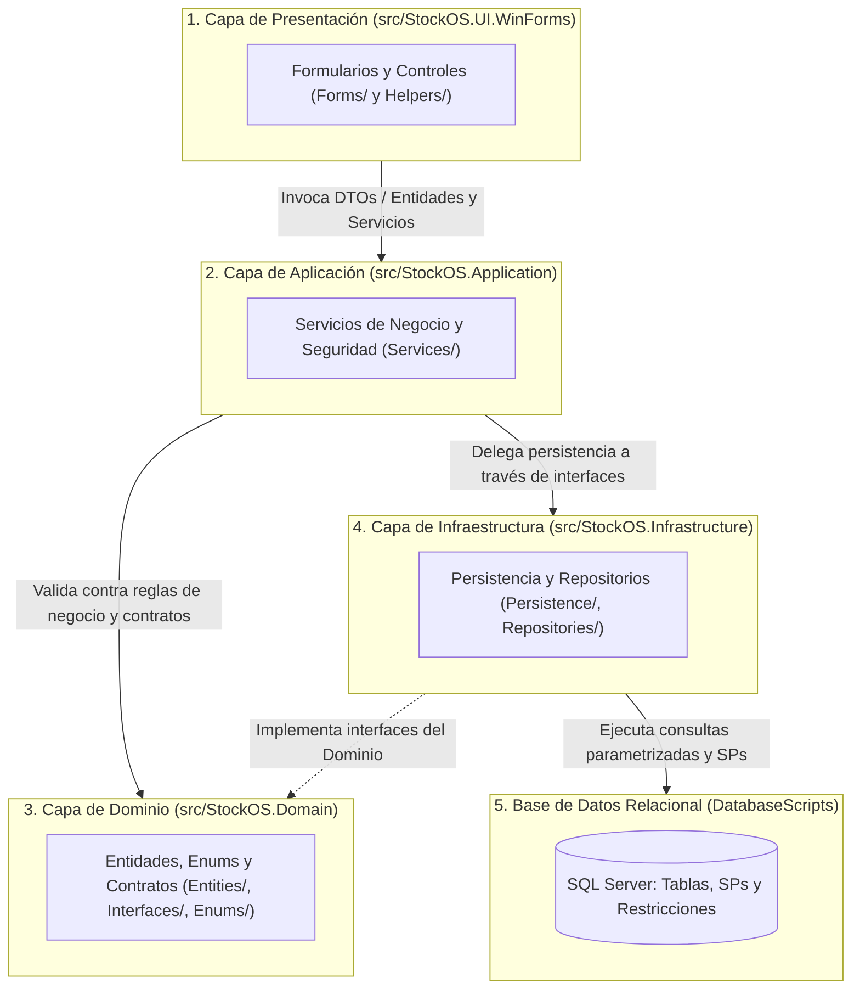
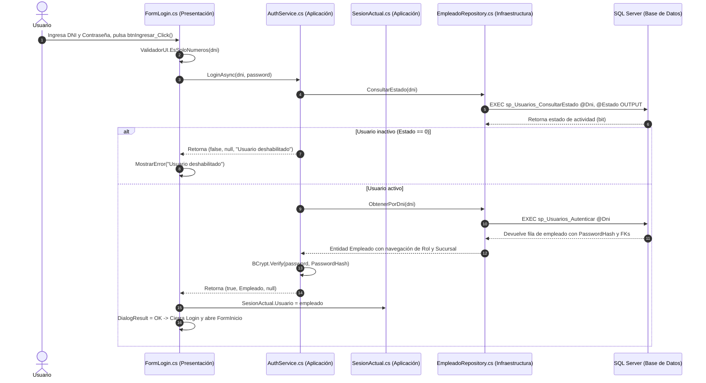
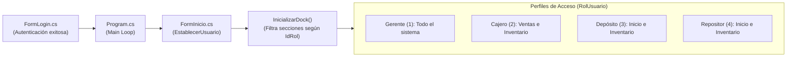
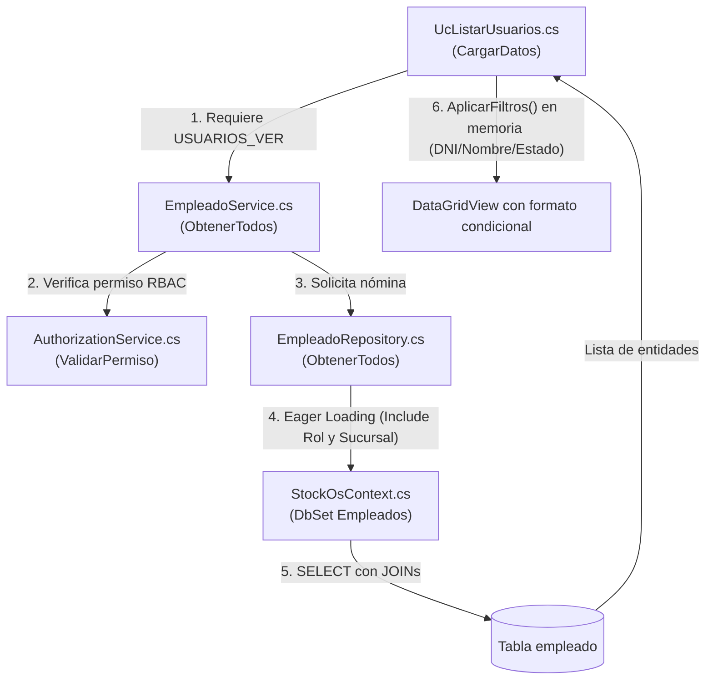
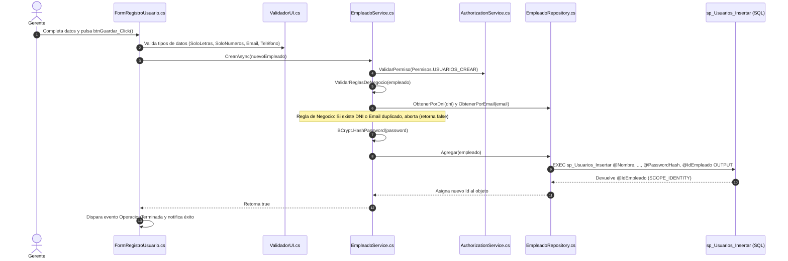
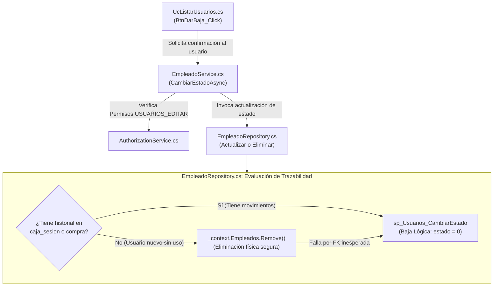

# INFORME TÉCNICO DE ARQUITECTURA: INTERACCIÓN ENTRE CAPAS EN EL MÓDULO DE USUARIOS

**Proyecto:** StockOS — Sistema de Punto de Venta (POS) y Gestión Integral de Stock  
**Arquitectura:** N-Tier / Clean Architecture Desacoplada (4 Capas + Base de Datos)  
**Tecnologías:** Microsoft .NET 8 (C#), Windows Forms, Entity Framework Core 8, Microsoft SQL Server 2022, BCrypt.Net  
**Área de Foco:** Módulo de Usuarios, Autenticación, Control de Acceso Basado en Roles (RBAC) y Seguridad  
**Fecha de Emisión:** Noviembre 2026  

---

## 1. Resumen Ejecutivo y Arquitectura Global de StockOS

El sistema **StockOS** está diseñado bajo un patrón arquitectónico en **capas estrictamente desacopladas** (*Layered / N-Tier Architecture*), garantizando la separación de responsabilidades y la inversión de dependencias (*Dependency Inversion Principle*). 

En el **aspecto de usuarios**, ninguna interacción directa ocurre entre la interfaz de usuario y las tablas físicas del motor relacional. Todas las operaciones de autenticación, alta, modificación, consulta y asignación de permisos viajan de manera unidireccional atravesando validaciones de entrada, filtros de autorización RBAC, lógica de dominio y repositorios transaccionales respaldados por Procedimientos Almacenados (*Stored Procedures*).

---

## 2. Mapa de Ubicación por Capa y Carpeta del Aspecto de Usuarios

A continuación se detalla la ubicación física exacta de cada componente relacionado con la gestión de usuarios dentro del árbol del proyecto:

| Capa | Carpeta Física | Archivo / Componente | Rol en el Aspecto de Usuarios |
| :--- | :--- | :--- | :--- |
| **Presentación** | `src/StockOS.UI.WinForms/Forms/` | [`FormLogin.cs`](file:///c:/Proyecto/StockOS/src/StockOS.UI.WinForms/Forms/FormLogin.cs) | Ventana de inicio de sesión. Captura credenciales y gestiona la apertura de la sesión global. |
| **Presentación** | `src/StockOS.UI.WinForms/Forms/` | [`FormInicio.cs`](file:///c:/Proyecto/StockOS/src/StockOS.UI.WinForms/Forms/FormInicio.cs) | Ventana principal (Shell MDI). Renderiza dinámicamente las opciones del dock según el rol del usuario. |
| **Presentación** | `src/StockOS.UI.WinForms/Forms/` | [`UcUsuarios.cs`](file:///c:/Proyecto/StockOS/src/StockOS.UI.WinForms/Forms/UcUsuarios.cs) | Contenedor principal del módulo de usuarios; alterna entre el menú, listado y formulario de registro. |
| **Presentación** | `src/StockOS.UI.WinForms/Forms/` | [`UcListarUsuarios.cs`](file:///c:/Proyecto/StockOS/src/StockOS.UI.WinForms/Forms/UcListarUsuarios.cs) | Control de grilla y filtros reactivos en vivo (búsqueda por DNI, nombre, email y estado). |
| **Presentación** | `src/StockOS.UI.WinForms/Forms/` | [`FormRegistroUsuario.cs`](file:///c:/Proyecto/StockOS/src/StockOS.UI.WinForms/Forms/FormRegistroUsuario.cs) | Formulario unificado de alta y edición de personal, vinculando roles y sucursales. |
| **Presentación** | `src/StockOS.UI.WinForms/Helpers/` | [`ValidadorUI.cs`](file:///c:/Proyecto/StockOS/src/StockOS.UI.WinForms/Helpers/ValidadorUI.cs) | Filtro de entrada en tiempo real mediante eventos `KeyPress` y avisos visuales ToolTip tipo globo. |
| **Presentación** | `src/StockOS.UI.WinForms/` | [`Program.cs`](file:///c:/Proyecto/StockOS/src/StockOS.UI.WinForms/Program.cs) | Contenedor de Inyección de Dependencias (IoC), configuración de logging y bucle de vida de la sesión. |
| **Aplicación** | `src/StockOS.Application/Services/` | [`AuthService.cs`](file:///c:/Proyecto/StockOS/src/StockOS.Application/Services/AuthService.cs) | Lógica de autenticación, verificación de contraseñas BCrypt y migración progresiva de credenciales. |
| **Aplicación** | `src/StockOS.Application/Services/` | [`EmpleadoService.cs`](file:///c:/Proyecto/StockOS/src/StockOS.Application/Services/EmpleadoService.cs) | Orquestador CRUD de usuarios, saneamiento de strings y validación de reglas de negocio. |
| **Aplicación** | `src/StockOS.Application/Services/` | [`AuthorizationService.cs`](file:///c:/Proyecto/StockOS/src/StockOS.Application/Services/AuthorizationService.cs) | Guardián central de autorización RBAC (*Role-Based Access Control*). |
| **Aplicación** | `src/StockOS.Application/Services/` | [`RolService.cs`](file:///c:/Proyecto/StockOS/src/StockOS.Application/Services/RolService.cs) | Servicio de consulta de roles para parametrización de interfaces de usuario. |
| **Aplicación** | `src/StockOS.Application/Services/` | [`SesionActual.cs`](file:///c:/Proyecto/StockOS/src/StockOS.Application/Services/SesionActual.cs) | Estado global estático en memoria que almacena la identidad del empleado activo y su turno. |
| **Dominio** | `src/StockOS.Domain/Entities/` | [`Empleado.cs`](file:///c:/Proyecto/StockOS/src/StockOS.Domain/Entities/Empleado.cs) | Entidad núcleo que modela los atributos del usuario, credenciales hasheadas y relaciones. |
| **Dominio** | `src/StockOS.Domain/Entities/` | [`Rol.cs`](file:///c:/Proyecto/StockOS/src/StockOS.Domain/Entities/Rol.cs) | Entidad del catálogo de roles del sistema comercial. |
| **Dominio** | `src/StockOS.Domain/Enums/` | [`RolUsuario.cs`](file:///c:/Proyecto/StockOS/src/StockOS.Domain/Enums/RolUsuario.cs) | Enumeración fuertemente tipada de perfiles de usuario (Gerente=1, Cajero=2, Depósito=3, Repositor=4). |
| **Dominio** | `src/StockOS.Domain/Enums/` | [`Permisos.cs`](file:///c:/Proyecto/StockOS/src/StockOS.Domain/Enums/Permisos.cs) | Constantes descriptivas de privilegios granulares (`USUARIOS_VER`, `USUARIOS_CREAR`, etc.). |
| **Dominio** | `src/StockOS.Domain/Interfaces/` | [`IEmpleadoRepository.cs`](file:///c:/Proyecto/StockOS/src/StockOS.Domain/Interfaces/IEmpleadoRepository.cs) | Contrato de operaciones de persistencia y consultas especializadas de usuarios. |
| **Dominio** | `src/StockOS.Domain/Interfaces/` | [`IRolRepository.cs`](file:///c:/Proyecto/StockOS/src/StockOS.Domain/Interfaces/IRolRepository.cs) | Contrato para recuperación de roles del sistema. |
| **Dominio** | `src/StockOS.Domain/Interfaces/` | [`IAuthorizationService.cs`](file:///c:/Proyecto/StockOS/src/StockOS.Domain/Interfaces/IAuthorizationService.cs) | Contrato de verificación de permisos sobre el contexto activo. |
| **Infraestructura** | `src/StockOS.Infrastructure/Repositories/` | [`EmpleadoRepository.cs`](file:///c:/Proyecto/StockOS/src/StockOS.Infrastructure/Repositories/EmpleadoRepository.cs) | Acceso a SQL Server mediante Entity Framework Core y ejecución directa de SPs con parámetros tipados. |
| **Infraestructura** | `src/StockOS.Infrastructure/Repositories/` | [`RolRepository.cs`](file:///c:/Proyecto/StockOS/src/StockOS.Infrastructure/Repositories/RolRepository.cs) | Acceso de solo lectura a la tabla de roles vía DbContext. |
| **Infraestructura** | `src/StockOS.Infrastructure/Persistence/` | [`StockOsContext.cs`](file:///c:/Proyecto/StockOS/src/StockOS.Infrastructure/Persistence/StockOsContext.cs) | Mapeo objeto-relacional (ORM), definición de claves, índices únicos y navegación relacional. |
| **Base de Datos** | `DatabaseScripts/` | [`00_CreacionCompleta.sql`](file:///c:/Proyecto/StockOS/DatabaseScripts/00_CreacionCompleta.sql) | DDL de la tabla `empleado` y Procedimientos Almacenados: `sp_Usuarios_Insertar`, `sp_Usuarios_Autenticar`, `sp_Usuarios_Actualizar`, `sp_Usuarios_CambiarEstado` y `sp_Usuarios_ConsultarEstado`. |

---

## 3. Interacción de Funciones entre Capas por Caso de Uso

En lugar de detallar cada línea de código, a continuación se explica **dónde reside cada función clave**, cómo colaboran entre sí a través de los límites arquitectónicos, y cuáles son sus **reglas de negocio** y **aspectos técnicos**.

---

### Caso de Uso 1: Autenticación e Inicio de Sesión (Login)

Este proceso valida la identidad del empleado frente a la base de datos, corrobora su vigencia operativa y levanta el entorno de trabajo personalizado.

#### Ficha de Funciones Involucradas:

1. **`btnIngresar_Click`**
   - **Capa y Carpeta:** Presentación (`src/StockOS.UI.WinForms/Forms/FormLogin.cs`)
   - **Regla de Negocio:** Impide el envío si los campos están en blanco o si el DNI contiene caracteres no numéricos. Notifica al usuario en la misma ventana sin bloquear el hilo de ejecución.
   - **Aspectos Técnicos:** Operación asíncrona (`async/await`). Inyecta el usuario autenticado en [`SesionActual.Usuario`](file:///c:/Proyecto/StockOS/src/StockOS.Application/Services/SesionActual.cs) y sincroniza el cierre preventivo de turnos de caja residuales mediante `ICajaService.CerrarCajaPorCierreSesion`.

2. **`LoginAsync`**
   - **Capa y Carpeta:** Aplicación (`src/StockOS.Application/Services/AuthService.cs`)
   - **Regla de Negocio:** La autenticación exige dos condiciones de negocio obligatorias: el usuario debe existir y su estado operativo debe ser estrictamente activo (`Estado == true`). Si está inactivo, el acceso es denegado explícitamente informando "Usuario deshabilitado", diferenciándolo de "Credenciales incorrectas".
   - **Aspectos Técnicos:** Verifica la contraseña utilizando `BCrypt.Net.BCrypt.Verify(password, hash)`. Cuenta con un mecanismo de resiliencia y retrocompatibilidad criptográfica: si detecta una contraseña legacy sin salt (`SaltParseException`), la valida, genera el hash BCrypt en tiempo real e invoca la actualización automática del registro en la base de datos sin requerir intervención manual del administrador.

3. **`ConsultarEstado` y `ObtenerPorDni`**
   - **Capa y Carpeta:** Infraestructura (`src/StockOS.Infrastructure/Repositories/EmpleadoRepository.cs`)
   - **Regla de Negocio:** Aislar la consulta de vigencia del usuario y la recuperación de credenciales de seguridad.
   - **Aspectos Técnicos:** Ejecutan los Stored Procedures `sp_Usuarios_ConsultarEstado` (mediante parámetro SQL `@Estado OUTPUT` de tipo `SqlDbType.Bit`) y `sp_Usuarios_Autenticar` usando `FromSqlRaw` con carga explícita de referencias relacionadas (`Entry.Reference().Load()` para `IdRolNavigation` e `IdSucursalNavigation`), previniendo consultas N+1.

4. **`sp_Usuarios_ConsultarEstado` y `sp_Usuarios_Autenticar`**
   - **Capa y Carpeta:** Base de Datos (`DatabaseScripts/00_CreacionCompleta.sql`)
   - **Regla de Negocio:** Consultar únicamente por clave unívoca indexada (`dni`), garantizando búsquedas de tiempo constante $O(1)$.
   - **Aspectos Técnicos:** `SET NOCOUNT ON`, ejecución compilada en el motor y utilización del índice único `UQ__empleado__D87608A799F5A209`.

---

### Caso de Uso 2: Control de Acceso por Roles (RBAC) y Configuración de Pantalla

StockOS no permite que roles de menor jerarquía tengan acceso visual o funcional a módulos no autorizados.

#### Ficha de Funciones Involucradas:

1. **`EstablecerUsuario` e `InicializarDock`**
   - **Capa y Carpeta:** Presentación (`src/StockOS.UI.WinForms/Forms/FormInicio.cs`)
   - **Regla de Negocio:** 
     - Si el rol es **Gerente**, el menú inferior expone todas las herramientas: Inicio, Inventario, Ventas, Reportes, Usuarios y Configuración.
     - Si es **Cajero**, se omiten Reportes, Usuarios y Configuración; además, por usabilidad (UX POS), se redirige automáticamente a la pantalla de Ventas.
     - Si es **Encargado de Depósito** o **Repositor**, el acceso queda restringido exclusivamente a Inicio e Inventario.
   - **Aspectos Técnicos:** Renderiza componentes visuales con redondeo personalizado (`RoundedPanel`) adaptando dinámicamente el ancho y posición del dock en función de la cantidad de opciones concedidas.

2. **`ValidarPermiso` y `TienePermiso`**
   - **Capa y Carpeta:** Aplicación (`src/StockOS.Application/Services/AuthorizationService.cs`)
   - **Regla de Negocio:** Valida que el rol del usuario actual posea el permiso requerido dentro de una matriz de seguridad en memoria antes de permitir que la capa de aplicación continúe con cualquier operación de lectura o escritura.
   - **Aspectos Técnicos:** Utiliza una estructura de diccionario de colecciones hash (`Dictionary<int, HashSet<string>>`) para evaluaciones en $O(1)$. Si el usuario carece del permiso, dispara una excepción de tipo `UnauthorizedAccessException` interrumpiendo el flujo antes de interactuar con la infraestructura.

---

### Caso de Uso 3: Consulta y Filtrado Reactivo de la Nómina (Listar Usuarios)

Este flujo permite auditar los usuarios del sistema con filtrado reactivo sin recargar la pantalla completa.

#### Ficha de Funciones Involucradas:

1. **`CargarDatos` y `AplicarFiltros`**
   - **Capa y Carpeta:** Presentación (`src/StockOS.UI.WinForms/Forms/UcListarUsuarios.cs`)
   - **Regla de Negocio:** Permite filtrar combinadamente por texto libre (coincidencia parcial en DNI, Nombre, Apellido o Correo) y por estado operativo (Todos, Solo Activos, Solo Inactivos). Aplica formateo visual condicional (verde esmeralda para activos, gris atenuado para inactivos).
   - **Aspectos Técnicos:** Almacena la nómina original en una lista privada (`_listaCompleta`) para que las búsquedas mediante LINQ (`Where()`) se ejecuten en memoria del cliente sin saturar de consultas el servidor SQL.

2. **`ObtenerTodos`**
   - **Capa y Carpeta:** Aplicación (`src/StockOS.Application/Services/EmpleadoService.cs`)
   - **Regla de Negocio:** Obliga a comprobar que la sesión posea el privilegio `Permisos.USUARIOS_VER`.
   - **Aspectos Técnicos:** Retorna `IEnumerable<Empleado>` desacoplando el tipo concreto de lista de la presentación.

3. **`ObtenerTodos` (Repositorio)**
   - **Capa y Carpeta:** Infraestructura (`src/StockOS.Infrastructure/Repositories/EmpleadoRepository.cs`)
   - **Regla de Negocio:** Recuperar la lista completa de empleados garantizando que los datos de rol y sucursal vengan completamente populados.
   - **Aspectos Técnicos:** Implementa *Eager Loading* a través de EF Core con `.Include(e => e.IdRolNavigation)` e `.Include(e => e.IdSucursalNavigation)`.

---

### Caso de Uso 4: Registro y Encriptación de Nuevo Empleado (Alta)

Garantiza la integridad referencial, unicidad de identidad y almacenamiento criptográfico irreversible de la credencial de acceso.

#### Ficha de Funciones Involucradas:

1. **`btnGuardar_Click`**
   - **Capa y Carpeta:** Presentación (`src/StockOS.UI.WinForms/Forms/FormRegistroUsuario.cs`)
   - **Regla de Negocio:** Exige obligatoriedad de todos los campos fundamentales (Nombre, Apellido, DNI, Email, Celular, Dirección, Rol, Sucursal y Contraseña inicial).
   - **Aspectos Técnicos:** Invoca las funciones estáticas de [`ValidadorUI.cs`](file:///c:/Proyecto/StockOS/src/StockOS.UI.WinForms/Helpers/ValidadorUI.cs) (`EsSoloLetras`, `EsSoloNumeros`, `EsTelefonoValido`, `EsEmailValido`). Ante errores de tipo, emite avisos directos y enfoca el control problemático con selección completa de texto.

2. **`CrearAsync` y `ValidarReglasDeNegocio`**
   - **Capa y Carpeta:** Aplicación (`src/StockOS.Application/Services/EmpleadoService.cs`)
   - **Regla de Negocio:** 
     - Exige el permiso `Permisos.USUARIOS_CREAR`.
     - Realiza saneamiento de cadenas (`Trim()`).
     - Aplica topes de longitud estrictos (Nombres $\le 50$, DNI $\le 20$, Email $\le 100$, Teléfono $\le 30$, Dirección $\le 200$).
     - Comprueba preexistencia de DNI o Correo electrónico para evitar excepciones no controladas de clave única.
   - **Aspectos Técnicos:** Hashea la contraseña en texto plano utilizando un salt dinámico de BCrypt (`BCrypt.HashPassword`) verificando previamente que no se encuentre ya hasheada (prefijo `$2`).

3. **`Agregar`**
   - **Capa y Carpeta:** Infraestructura (`src/StockOS.Infrastructure/Repositories/EmpleadoRepository.cs`)
   - **Regla de Negocio:** Persistir el nuevo usuario manteniendo el estado por defecto activo (`1`).
   - **Aspectos Técnicos:** Parametriza fuertemente cada columna con `SqlParameter` para prevenir inyecciones SQL y captura el ID generado en el motor mediante un parámetro de salida `@IdEmpleado OUTPUT` vinculado a `SCOPE_IDENTITY()`.

4. **`sp_Usuarios_Insertar`**
   - **Capa y Carpeta:** Base de Datos (`DatabaseScripts/00_CreacionCompleta.sql`)
   - **Regla de Negocio:** Inserción atómica en la tabla `empleado`.
   - **Aspectos Técnicos:** Control de unicidad respaldado por las restricciones de base de datos `UQ__empleado__D87608A799F5A209` (DNI) y `UQ__empleado__AB6E61640605CC37` (Email).

---

### Caso de Uso 5: Modificación de Personal y Actualización de Contraseña

Permite actualizar los atributos del empleado permitiendo dejar la contraseña intacta a menos que se ingrese un nuevo valor.

#### Ficha de Funciones Involucradas:

1. **`btnGuardar_Click` (Modo Edición)**
   - **Capa y Carpeta:** Presentación (`src/StockOS.UI.WinForms/Forms/FormRegistroUsuario.cs`)
   - **Regla de Negocio:** Si el campo de contraseña queda vacío, conserva la contraseña existente en la base de datos sin sobreescribirla ni corromperla.
   - **Aspectos Técnicos:** Diferencia el flujo mediante la variable de estado `_empleadoEdicion`. Actualiza las propiedades del modelo en memoria y pasa la entidad a la capa de aplicación.

2. **`ActualizarAsync`**
   - **Capa y Carpeta:** Aplicación (`src/StockOS.Application/Services/EmpleadoService.cs`)
   - **Regla de Negocio:** 
     - Requiere el permiso `Permisos.USUARIOS_EDITAR`.
     - Valida colisiones cruzadas: si el DNI o el Email ya existen en otro empleado diferente (`IdEmpleado != emp.IdEmpleado`), deniega la actualización informando con precisión qué dato está en conflicto.
   - **Aspectos Técnicos:** Retorna una tupla informativa `(bool Exito, string Mensaje)`. Si se proporcionó una nueva contraseña, la hashea con BCrypt antes de pasar al repositorio.

3. **`Actualizar` y `sp_Usuarios_Actualizar`**
   - **Capa y Carpeta:** Infraestructura (`src/StockOS.Infrastructure/Repositories/EmpleadoRepository.cs`) y Base de Datos (`DatabaseScripts/00_CreacionCompleta.sql`)
   - **Regla de Negocio:** Aplicar los cambios en el registro preservando la clave anterior si no hubo modificaciones.
   - **Aspectos Técnicos:** En el Stored Procedure, la columna de contraseña se actualiza mediante `password_hash = COALESCE(@PasswordHash, password_hash)`. Si la capa de infraestructura envía `DBNull.Value`, el motor mantiene intacto el hash previo.

---

### Caso de Uso 6: Baja Lógica, Reactivación y Protección de Integridad Histórica

StockOS aplica una política estricta de auditoría: ningún usuario que haya participado en operaciones comerciales puede ser eliminado físicamente de la base de datos.

#### Ficha de Funciones Involucradas:

1. **`BtnDarBaja_Click`**
   - **Capa y Carpeta:** Presentación (`src/StockOS.UI.WinForms/Forms/UcListarUsuarios.cs`)
   - **Regla de Negocio:** Permite tanto la desactivación como la reactivación instantánea del empleado previa confirmación por cuadro de diálogo (`MessageBoxButtons.YesNo`).
   - **Aspectos Técnicos:** Invoca `CambiarEstadoAsync` invirtiendo el valor booleano (`!emp.Estado`) y refresca automáticamente la grilla al finalizar.

2. **`CambiarEstadoAsync` y `EliminarAsync`**
   - **Capa y Carpeta:** Aplicación (`src/StockOS.Application/Services/EmpleadoService.cs`)
   - **Regla de Negocio:** Protegido con `Permisos.USUARIOS_EDITAR`.
   - **Aspectos Técnicos:** Recupera la entidad por ID, actualiza el flag y persiste el cambio.

3. **`Eliminar` y `sp_Usuarios_CambiarEstado`**
   - **Capa y Carpeta:** Infraestructura (`src/StockOS.Infrastructure/Repositories/EmpleadoRepository.cs`) y Base de Datos (`DatabaseScripts/00_CreacionCompleta.sql`)
   - **Regla de Negocio (Integridad Referencial y Auditoría):** Comprueba si el empleado tiene registros relacionados en las tablas `caja_sesion` o `compra`. Si posee historial, conmuta a una **baja lógica** ejecutando `sp_Usuarios_CambiarEstado @IdEmpleado, @Estado=0` preservando la integridad histórica y evitando fallas por clave foránea (`FK`). Si no tiene movimientos, intenta la eliminación física con bloque `try/catch` de contingencia.

---

### Caso de Uso 7: Cierre de Sesión (Logout) y Limpieza de Recursos

Garantiza que al finalizar la jornada o cambiar de usuario no queden turnos de caja huérfanos ni estados en memoria residuales.

#### Ficha de Funciones Involucradas:

1. **`BtnCerrarSesion_Click` y `OnFormClosing`**
   - **Capa y Carpeta:** Presentación (`src/StockOS.UI.WinForms/Forms/FormInicio.cs`)
   - **Regla de Negocio:** Al cerrar sesión o salir de la ventana principal, se debe cerrar preventivamente cualquier turno de caja que el usuario haya dejado abierto.
   - **Aspectos Técnicos:** Invoca `_cajaService.CerrarCajaPorCierreSesion(usuario.IdEmpleado)` y finaliza con [`SesionActual.Limpiar()`](file:///c:/Proyecto/StockOS/src/StockOS.Application/Services/SesionActual.cs).

2. **`Main` (Bucle de Sesión)**
   - **Capa y Carpeta:** Presentación (`src/StockOS.UI.WinForms/Program.cs`)
   - **Regla de Negocio:** Permitir el reingreso continuo de diferentes cajeros o supervisores sin reiniciar la aplicación ni degradar la memoria.
   - **Aspectos Técnicos:** Utiliza un bucle infinito `while (true)` con ámbitos de inyección de dependencias desechables (`using (var scope = host.Services.CreateScope())`). Cuando el formulario principal se cierra con `LogoutRequested == true`, el bucle destruye el scope previo (liberando memoria del `DbContext`) y vuelve a instanciar un nuevo `FormLogin`.

---

## 4. Matriz Comparativa: Interacción de Funciones, Capas y Reglas

La siguiente matriz sintetiza el funcionamiento de cada método analizado en el módulo de usuarios:

| Función / Método | Capa | Carpeta Física | Interacción con Otras Capas | Reglas de Negocio | Aspectos Técnicos |
| :--- | :--- | :--- | :--- | :--- | :--- |
| **`btnIngresar_Click`** | Presentación | `src/StockOS.UI.WinForms/Forms/` | Invoca a `IAuthService` (Aplicación) y `ICajaService` | Valida completitud de DNI y contraseña; no permite caracteres no numéricos. | Evento `async void`, asignación a `SesionActual` estática y cierre de ventana con `DialogResult.OK`. |
| **`LoginAsync`** | Aplicación | `src/StockOS.Application/Services/` | Llama a `IEmpleadoRepository` (Infraestructura) | El empleado debe existir y estar activo (`Estado == true`). Distingue usuario deshabilitado de credencial errónea. | Verificación de salt con `BCrypt.Verify`. Auto-migración progresiva de claves heredadas en texto plano. |
| **`ConsultarEstado`** | Infraestructura | `src/StockOS.Infrastructure/Repositories/` | Ejecuta SP en SQL Server | Solo consulta el flag de habilitación para validación previa al login. | Ejecuta `sp_Usuarios_ConsultarEstado` con parámetro de salida `SqlDbType.Bit`. |
| **`ObtenerPorDni`** | Infraestructura | `src/StockOS.Infrastructure/Repositories/` | Ejecuta SP en SQL Server | Recupera el usuario con sus relaciones comerciales y de rol. | `FromSqlRaw` con `sp_Usuarios_Autenticar` y carga explícita de `IdRolNavigation` e `IdSucursalNavigation`. |
| **`EstablecerUsuario`** | Presentación | `src/StockOS.UI.WinForms/Forms/` | Consume `SesionActual` y entidad `Empleado` | Si es cajero abre directo en Ventas; si es gerente expone todo; depósito/repositor solo Inventario. | Enrutamiento condicional y reconfiguración visual del contenedor `RoundedPanel`. |
| **`ValidarPermiso`** | Aplicación | `src/StockOS.Application/Services/` | Consulta `SesionActual.Usuario` | Protege operaciones críticas de usuarios según el rol activo. | Lanza `UnauthorizedAccessException` inmediata si la colección del rol no posee la clave de permiso. |
| **`CargarDatos`** | Presentación | `src/StockOS.UI.WinForms/Forms/` | Consume `IEmpleadoService` (Aplicación) | Solo accesible por roles con privilegio de visualización. | Carga la grilla desacoplando el filtrado en memoria (`_listaCompleta`) para alta respuesta en UI. |
| **`btnGuardar_Click`** | Presentación | `src/StockOS.UI.WinForms/Forms/` | Invoca `ValidadorUI` y `IEmpleadoService` | Campos obligatorios y validación de tipos antes de cruzar capas. | Previene excepciones de base de datos capturando errores de formato en cliente mediante ToolTips. |
| **`CrearAsync`** | Aplicación | `src/StockOS.Application/Services/` | Invoca `IAuthorizationService` y `IEmpleadoRepository` | Exige unicidad de DNI y Email. Valida longitudes máximas y formato de nombres. | Exige `Permisos.USUARIOS_CREAR`, limpia espacios en blanco y hashea con `BCrypt.HashPassword`. |
| **`ActualizarAsync`** | Aplicación | `src/StockOS.Application/Services/` | Invoca `IAuthorizationService` y `IEmpleadoRepository` | No permite colisión de DNI/Email con otros empleados. Mantiene password si no se ingresa una nueva. | Exige `Permisos.USUARIOS_EDITAR`, retorna tupla con diagnóstico y gestiona hashing condicional. |
| **`BtnDarBaja_Click`** | Presentación | `src/StockOS.UI.WinForms/Forms/` | Llama a `IEmpleadoService.CambiarEstadoAsync` | Pide confirmación explícita para evitar modificaciones accidentales. | Invierte el estado booleano y refresca la vista visualmente con estilos condicionales. |
| **`Eliminar`** | Infraestructura | `src/StockOS.Infrastructure/Repositories/` | Consulta `StockOsContext` y ejecuta SP | Conserva la integridad referencial y la auditoría histórica de comprobantes. | Si el usuario tiene registros en `caja_sesion` o `compra`, conmuta a baja lógica llamando a `sp_Usuarios_CambiarEstado`. |
| **`Limpiar`** | Aplicación | `src/StockOS.Application/Services/` | Manipula estado de `SesionActual` | Garantiza que no queden datos del usuario previo en memoria. | Resetea referencias a `null` al hacer logout o salir del sistema. |

---

## 5. Aspectos Técnicos de Seguridad y Concurrencia

1. **Inyección de Dependencias y Ciclo de Vida (*Scoped* vs *Transient*):**  
   - Los servicios de aplicación y repositorios están registrados con ciclo de vida **`Scoped`** en [`Program.cs`](file:///c:/Proyecto/StockOS/src/StockOS.UI.WinForms/Program.cs#L78-L109). Cada sesión de usuario genera un ámbito (`IServiceScope`) nuevo, aislando las instancias de `StockOsContext` y previniendo la contaminación de memoria o bloqueos por entidades cacheadas entre diferentes sesiones.
   - Las ventanas y controles de usuario son **`Transient`**, creándose limpias cada vez que se solicitan.

2. **Criptografía Robusta con BCrypt:**  
   - Las contraseñas nunca viajan ni se almacenan en texto plano en la base de datos.
   - Se utiliza el algoritmo adaptativo **BCrypt** que genera de forma implícita una sal aleatoria (*Salt*) para cada registro, neutralizando ataques basados en tablas arcoíris (*Rainbow Tables*).

3. **Prevención Estricta de Inyecciones SQL:**  
   - Todas las llamadas a Procedimientos Almacenados en [`EmpleadoRepository.cs`](file:///c:/Proyecto/StockOS/src/StockOS.Infrastructure/Repositories/EmpleadoRepository.cs) utilizan objetos parametrizados `SqlParameter` con tipos de datos explícitos (`SqlDbType.VarChar`, `SqlDbType.Int`, `SqlDbType.Bit`), garantizando que cualquier valor ingresado sea tratado estrictamente como literal y nunca como código ejecutable.

4. **Integridad Relacional en Base de Datos (3NF):**  
   - La tabla `empleado` posee restricciones de clave foránea hacia `rol` (`FK__empleado__id_rol`) y hacia `sucursal` (`FK__empleado__id_sucursal`), complementadas con índices únicos en `dni` y `email`. Esto asegura consistencia a nivel de motor aún frente a escenarios imprevistos de concurrencia.

---

## 6. Conclusión

El diseño del aspecto de usuarios en **StockOS** demuestra una arquitectura desacoplada, sólida y conforme a las mejores prácticas de la ingeniería de software:
- La **Capa de Presentación** se encarga de la experiencia de usuario y validación inmediata de entradas.
- La **Capa de Aplicación** resguarda las reglas del negocio, el control de acceso granular mediante roles (RBAC) y la seguridad criptográfica.
- La **Capa de Dominio** proporciona los contratos puros e invariables del negocio.
- La **Capa de Infraestructura y Base de Datos** asegura la persistencia atómica, eficiente y auditada mediante Procedimientos Almacenados y mecanismos de baja lógica.
